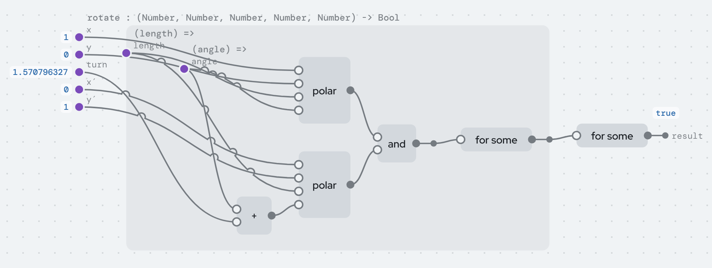

# What's confusing, and what could be simpler

This list used to be the last part of the [tutorial](../learn/TUTORIAL.md).
It's for us, not for readers learning the language, so it lives here now.
Each problem that is still open is also a row in
[BACKLOG.md](../../BACKLOG.md), the project's one list of open work, named
under its item. Checked against the editor on 2026-11-13 (E256).

This is the candid part. Each item says what's there today, why it's a
problem, and a proposal. [REVIEW-2026-10-26.md](../reports/reviews/REVIEW-2026-10-26.md) has
the latest longer review, [BACKLOG.md](../../BACKLOG.md) the order of work,
and [NOTES.md](../history/NOTES.md) the early design discussion behind them. Fixed items are at the end, so the list shows what moved.

### 1. ~~The graph still crosses itself~~ (decided 2026-11-13)

**Today.** The node editor work (NODE-EDITOR.md) fixed most of what made the
graph hard to read: values are chips that avoid nodes and each other, nodes
stay where you put them, *Tidy* spaces things out, crossings get bridges and
tunnels, and a value used far away can be a let node with get nodes. What's
left shows in `rotate`:

- *Tidy* now reorders the nodes in each column where that cuts crossings
  (Sugiyama's barycenter step), and no longer pushes a node off one wire
  across others: over the examples, a tidy leaves about 9% fewer crossings
  than before it, where it used to add about 27%. Wires that fan out from
  one frame's inputs to nodes far apart still weave.
- A wire bends over or under a node in its way when that's a short detour
  that crosses no more wires; across the examples that leaves 136 of the 333
  tunnels, for 28 more bridges (438 from 410). The rest still pass under
  nodes, and wires still pass over input names: in `insert`, `tail` and
  `tail′` are hidden under wires.
- A frame you aren't reading folds into one box (▾ in its corner): in
  `queens`, folding the `(row, rows, board) =>` frame leaves four nodes on
  the canvas instead of ten. ▸ unfolds it where it was.

**Proposal.** Names drawn with a background so a wire can't cover them, and
wires routed around nodes.

**2026-11-13: decided, closed.** In `rotate` unfolded, the frames draw
over their neighbours (the inner `for some` node lands inside the frame it
takes, over the first `polar`'s `x` input) and wires cross the frame edges.
That is the design: an unfolded frame opens where its box was, over its
neighbours, and nothing else moves; *Tidy everything* spaces them out,
and after it `rotate` reads cleanly (each `for some` right of its frame).
Ersagun has decided this several times (2026-11-01, again 2026-11-13: "Draw
over neighbors"). Row E257 closed with it.

### 2. Cases that are values are drawn as functions

**Today.** The `then` and `else` of an `if`, and every case with no fields
(`nil`), are drawn inside `() =>` frames, because internally they run only
when chosen. In `queens`, `fail` sits inside its own frame under `else`, and
`nil` inside another; in `magnitude`, the `else` frame holds nothing but a
wire.

**Proposal.** Draw a zero-input frame as just its contents, with no box,
unless it's a real action passed to a handler like `first` or `all`.

**2026-11-13.** Still so: in `queens`, `nil`, the `then` (`cons(column,
board)`) and the `else` (`fail()`) each sit in a `() =>` frame. Row
**E258**.

### 3. "Output" and "dot" are almost the same thing

**Today.** A node's output is a filled circle on its right. Dragging it to a
second input creates a dot on its wire. Inputs of functions are dots, the
solved ports of a `solve` node are dots, but a node's output isn't.

**Proposal.** Every output is a dot. A value used once is a dot with one
wire; there's nothing to create when you use it a second time. That removes
one shape and one gesture.

**2026-11-13.** Still so. Row **E259**.

### 5. `for some` is two nodes for two wires

**Today.** `rotate`'s two internal wires, `length` and `angle`, now share one
frame, but each still has its own `for some` node, one feeding the other.
The picture of "a wire that isn't an input" is a frame and two nodes.

**Proposal.** One `for some` node for all of a frame's unknowns, or draw an
existential as a dot inside the frame with no wire coming in, labelled
"some".

**2026-11-13.** Still so: `rotate` is `for some((length) => for some((angle)
=> …))`, two frames and two nodes. Row **E260**.

### 6. ~~Effects: nine of them, and the editor shows three~~ (done)

*+ New definition* has a fourth kind, **Effect**: its cases are called
operations, their fields inputs, and each operation says what it gives back
(or "nothing: it never returns", like `abort`). The palette offers
`handle Ask in □` for every effect, and the blocks view writes a handler
match as `handle`, so it reads differently from a match on data while staying
the same node. The guide lists the effects, and the **Effects** example uses
a declared effect and `Abort`, built in the editor by clicks only.

What's left is the three ways to say "no answer" (`Choice`, `Abort`,
`Optional`); [tutorial 3.9](../learn/TUTORIAL.md#39-effects) gives the rule of thumb.

### 7. The type syntax has a variable most people won't understand

**Today.** Types like `(List a, (a) -[e]-> b) -[e]-> List b` show `e`, a row
variable meaning "whatever effects the function you pass has". `root near`'s
type is `((Float64) -[Choice, Diverge, e]-> Float64, Float64) -[Choice, e]->
Float64`.

**Proposal.** Show it in words on hover ("has the effects of `f`") and hide
`e` by default. The badges already say what a node does.

**2026-11-13.** Still so: the blocks show `newton : ((Float64) -[Choice,
Diverge, e]-> Float64, …) -[Choice, Diverge, e]-> Float64` and Markov's
`shown : (() -[Choice, e]-> List Float64) -[e]-> Text`. Row **E261**.

### 9. Small inconsistencies worth fixing

- `+` is still three built-ins in tree code (`add`, `subtract`, `negate`), each
  with its own equation, where one sum `a + b = total` read in different
  directions would do. Row **L244**.
- `Int` and `Float64` share every operation's name. The types tell them apart
  and the palette only offers the right one, but a reader of the blocks can't
  see which `+` it is. Kept: one name per operation is what the generic
  operations (`+` on any number type) are for, and clicking a part shows its
  type.

### 11. Things that are good and should stay

So the list above isn't read as "everything is wrong":

- Names, comments, layout and examples outside the code. Rename, notation,
  layout and example values never change meaning, and the *Files* tab shows it.
- Holes with types and a palette of only what fits.
- *Add a case* adding holes everywhere.
- One `Choice` effect covering search, absence, filtering and every backwards
  run.
- Any function runs backwards, including printers, which become parsers.
- Derivatives read off real functions, generated as definitions you can open.
- Non-termination as an inferred effect, rather than a promise.
- Libraries by content hash, with no import statements.

### Fixed since the first version of this list

- ~~**Order is shown by position only.**~~ (Was item 4.) An action's steps
  keep their order in one column wherever the layout puts them, and a dashed
  line leads from each step to the next, so the order is drawn, not only
  placed.
- ~~**Three ways to repeat.**~~ (Was item 8.) The tutorial (3.8) teaches
  fold first, then a function calling itself as what the checker can see
  ends, and `with fuel` as a budget that turns `Diverge` into `Choice`.
- ~~**Cells: the handler is the runtime's, and lazy producers say
  Diverge.**~~ (Was item 10.) Handlers with state are in the language
  (`with state`, L16a), so a program can write a handler that keeps a value
  between operations, and guarded corecursion (L16) drops `Diverge` from a
  producer whose every call into itself is inside a constructor's field.
  Cells' own handler stays the runtime's, where reactivity is.
- ~~**Small inconsistencies.**~~ (Parts of item 9.) The palette names every
  filling (`match □ · Type`, `handle Ask in □`), with no empty names. `equal`
  on numbers is exact (L197), with `near(a, b)` for "the same up to
  rounding". The docs have one index ([docs/README.md](../README.md)) and one
  reference folder ([language/](../language/)), and dated reports are kept
  as written instead of restating the model.

- ~~**Sequences are drawn as nesting.**~~ Adjacent `print`s and lets are
  one flat list in the blocks and one column in the graph, and a `cons`
  chain ending in `nil` is one `list` node with an input per item. The tree
  is unchanged; it's a view. (Showing `succ(succ(zero))` as `2` is the same
  idea, not done yet.)
- ~~**The graph doesn't scale.**~~ Mostly fixed (NODE-EDITOR.md): value chips
  that don't overlap, free positions, *Tidy*, bridges and tunnels, let and
  get nodes, a right-click menu, *Fit* centred, a resizable canvas. What's
  left is item 1.
- ~~**Captioned wires and named dots look alike.**~~ Values are chips with a
  border; names are plain text on a dot, a port or a let node, and nothing
  else puts text on a wire. A name on a wire would just be one more way to
  draw a named dot (NOTES.md, "The node editor").
- ~~**Libraries are visible but frozen.**~~ *Copy into my program* makes a
  draft of a library definition you can change, and *Pin this type* freezes
  one of your own definitions' type.
- ~~**`if` shows its cases in stored order.**~~ It's always `condition`,
  `then`, `else`.
- ~~**Two worlds of functions.**~~ A network is now a function returning
  `Bool`, built from `equal`, `and`, `for some` and `hence`; one interpreter
  runs every backwards direction, and the network node kinds, editor and
  checker are gone (LANGUAGE.md, "One world").
- ~~**Builtins are black boxes, and arithmetic exists three times.**~~ There's
  one table of arithmetic (evaluate, invert, differentiate); selecting a
  built-in shows its equation and directions; the data-type algebra demo was
  replaced by calculus on real functions. (What's left is item 9's three
  `+`s.)
- ~~**Relations only cover arithmetic.**~~ Every node runs backwards
  (BACKWARDS.md), and pattern matching *is* a constructor run backwards.
- ~~**Units only exist in networks.**~~ Units are part of `Float64`'s type in
  every program.
- ~~**`equal` works on functions; `show` only on numbers.**~~ `equal` needs plain
  data; `show` prints any plain value.
- ~~**The editor can't make anything.**~~ New programs, definitions, data types
  and inputs; save and open files; copy and paste; values on wires.
- ~~**Absence and errors have no reason.**~~ `Abort`, `Optional` and effects you
  declare.
- ~~**Totality has holes.**~~ Strictly positive types, size-change termination,
  no recursive values (REVIEW.md §1).
