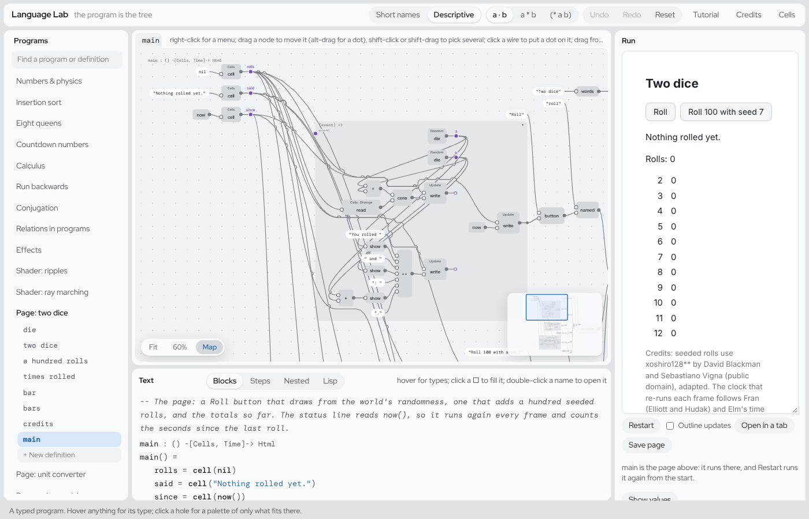
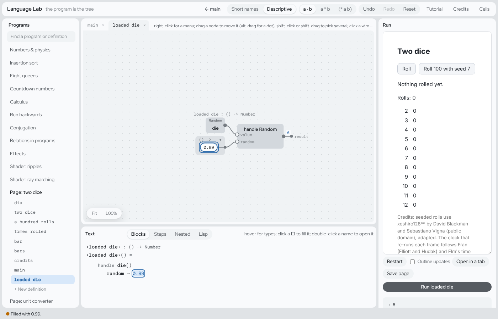

# A hands-on guide to the editor and Ters, the language

Do this tour with the editor open beside it:
https://ersagunkuruca.github.io/language-lab/.

We start from one small program, *Page: two dice*, and change it with real
edits. Each section is short. Each one ends with one thing to try.

New words are explained when they first come up. There's a list of them
at the end.

Each section's Try it has the editor right below it, so you can do it in
this page. Edits there are only for trying: they aren't kept, and they
don't change your programs in the editor.

Want the ideas first? [Learn](LEARN.md) has a gentle start for new
programmers and one for people new to functional programming. The
[tutorial](TUTORIAL.md) goes deeper, and [LANGUAGE.md](../language/LANGUAGE.md) has
every detail.

---

## 1. What you're looking at

Open the editor. In the **Programs** list on the left, pick
**Page: two dice**.

Under the program's name are its **definitions**. A definition is a named
piece of the program, usually a function. This one has `die`, `two dice`,
`a hundred rolls`, `times rolled`, `the first`, `most`, `bar`, `bars`,
`landed`, `credits` and `main`.



The window has four parts:

- **Programs**, on the left. Click a definition to open it.
- **The graph**, in the middle at the top. The definition is drawn as
  boxes (**nodes**) joined by **wires**. Data flows from left to right.
- **Text**, in the middle below the graph. It's the same definition,
  written out. **Blocks** is the view to read. Steps, Nested and Lisp are
  other ways of writing the same thing.
- **Run** and the **inspector**, on the right. Run runs things. The
  inspector shows what you've selected.

The graph and the text are two drawings of the same thing.

There's no source file underneath. The program is a tree of parts, and
both views draw that tree. You never type the program: you pick its
parts. So you can't make a typo or a syntax error.

**Try it:**

1. Click **Roll** a few times on the page in the Run pane.
2. Click **Throw 100** a few times and watch the bars. The green bars grow
   toward the red ticks, which show what fair dice give on average.
3. Click **Roll 100 with seed 7** twice. You get the same hundred rolls
   both times.

?[main of two dice, read-only: the page runs under Run](index.html?embed&readonly&program=dice&def=main)

## 2. Reading one definition, two ways

Click **die** in the list. The Blocks text says:

```
die : () -[Random]-> Float64
die() = floor(random() · 6) + 1
```

The first line is the **type**. It says what goes in, what comes out, and
what else the function does along the way. Section 4 is about types.

The second line is the body. Take a random number from 0 up to 1, times 6.
Round it down and add 1. That gives a whole number from 1 to 6.

The graph shows the same body as boxes. `random` and `6` feed `·`. That
feeds `floor`, which feeds `+` with `1`. The last wire goes to `result` on
the right.

Some boxes have a small grey word above them, like **Random**. That's a
**badge**. It means the box does something besides work out a value.

A few things to know while reading:

- **Hover** over any part of the Blocks text to see its type.
- **Double-click** a name to open that definition. **← main** at the top
  takes you back.
- **Click** a part to select it. The inspector says what it is and what
  you can do with it.
- A name in `‹…›` is a name with spaces in it. `‹two dice›` is one name.

**Try it:** open `two dice` and `a hundred rolls`, and read each one in
both views. In `a hundred rolls`, find `seed` in the graph. An input is a
purple **dot** on the left edge. Every place that uses it gets a wire from
that dot.

?[a hundred rolls, read-only: hover and click to read it](index.html?embed&readonly&program=dice&def=a%20hundred%20rolls)

## 3. Changing a value: holes and the palette

To change a part of a program, you take it out and put something else in.

Taking a part out leaves a **hole**, drawn `□`. A hole knows what type
belongs in it. The inspector lists only the things that fit. That list is
the **palette**.

Let's make the "Roll 100" button use a random seed instead of 7. Open
**main** and find this line in the Blocks text:

```
write(rolls, append(‹a hundred rolls›(7), read(rolls)))
```

1. Click the `7`. The inspector says **Literal**, which means a value
   written out, of type `Float64`.
2. Press **Delete**. The `7` becomes a hole, `□Float64`, and the palette
   opens.
3. Type `die` in the palette's search and click `die()`.


The status line at the bottom says *Filled with die(). No holes left in
this definition.*

The page runs again. Now each click on that button rolls a die for the
seed, so you get one of six different hundreds. The label still says
"seed 7". That's only text, and you can change it the same way.

The palette sorts what fits into groups:

- **in scope**: inputs and names you can reach from here
- **calls**: functions, each with a hole for every input
- **constructors** and **literals**

You can also type a value, like `3`, `"hi"` or `[1, 2]`, or a short sum,
like `x + 1`.

**Undo**, in the top bar, takes back any edit, one step at a time.

**Try it:** put the `7` back with Undo. Then do the edit again, but pick
`two dice()` instead of `die()`.

?[main of two dice, live: edits here stay in this page](index.html?embed&program=dice&def=main)

## 4. Reading a type

Every definition's first line is its type. Read the arrow as "takes …,
gives …".

| type | read it as |
|---|---|
| `die : () -[Random]-> Float64` | takes nothing, gives a Float64, and uses **Random** on the way |
| `a hundred rolls : (Float64) -> List Float64` | takes a Float64, gives a list of Float64s, and does nothing else |
| `times rolled : (List a, a) -> Int` | takes a list of anything, and one more thing of the same kind, and gives a whole number |
| `main : () -[Cells, Time]-> Html` | takes nothing, gives a page, and uses cells and the clock |

The words between `-[` and `]->` are the function's **effects**. Effects
are things a function does besides give back a value. A plain `->` means
it has none. Section 5 is about effects.

A lowercase letter like `a` means "any type". It has to be the same type
everywhere `a` appears. `times rolled` counts how many items in a list
equal the one you give it. So it works on lists of numbers, of text, of
anything.

Nobody wrote these types. The editor works them out from the body, and
updates them as you edit.

**Try it:** open `times rolled`, then `bar`. Say each type out loud
before you hover over its parts.

?[times rolled, read-only: hover a part to see its type](index.html?embed&readonly&program=dice&def=times%20rolled)

## 5. Effects and handlers: the dice and the clock

An **effect** is something a function asks for while it runs: a random
number, the time, a line printed.

The function only asks. Something outside it answers. That something is
called a **handler**.

`die` asks for a random number with `random()`. Who answers depends on
where `die` is called. There are three possibilities.

**Nobody answers, so the world does.** Open `die` and press **Run die**
in the Run pane. You get a fresh number each time, from the browser.

**`seeded` answers.** `a hundred rolls` is:

```
seeded(seed, map(range(100), (i) => ‹two dice›()))
```

Everything inside `seeded` gets its random numbers from the seed. So the
same seed always gives the same hundred rolls. That's why `a hundred
rolls` has no `Random` in its type: the question is asked inside it, and
answered inside it too.

**You answer.** You can write your own handler. It looks like a `match`,
with one line for each question the effect can ask. Those questions are
the effect's **operations**.

Let's make a loaded die that always rolls 6:

1. Under the definitions, click **+ New definition**. Name it
   `loaded die`, leave the inputs empty, and press **Create**.
2. Its body is a hole. Type `handle` in the palette and pick
   **handle Random in □**.
3. The first hole is what to run. Pick `die()`.
4. The other hole is the answer to `random`. Type `0.99` and press Enter.



```
loaded die : () -> Float64
loaded die() =
  handle die()
    random → 0.99
```

Press **Run loaded die**. It's always 6. Its type is `() -> Float64`,
with no Random, because the handler answered every question.

**The clock** is another effect, `Time`, which you ask with `now()`.
`landed` reads `now()` to work out how many of a hundred throws have
landed so far. In `main`, the bars and the status line show `landed`, so
they update every frame. One throw lands every 20 ms.

**Why `die()` can't be the seed inside `a hundred rolls`.** In
`seeded(die(), …)`, the die is rolled *before* `seeded` starts. So
`seeded` doesn't answer it, and `a hundred rolls` would get `Random` in
its type. Section 9 shows what the editor does about that. Using `die()`
in `main` works, as in section 3, because a button is allowed to use
Random.

**Try it:** open the **Effects** program, then `area`, and press its Run.
It tells you that nothing answers `Ask`. Then read `main` to see who
does, and run it.

?[area, live: run it and read what it says](index.html?embed&program=effects&def=area)

## 6. Choice: search without writing a search

`Choice` is the effect of "pick one of these". The program can also say
"this pick is no good", with `fail()`.

Open **Eight queens**, then `queens`:

```
column = ‹one of›(range(size))
if safe(column, board) then cons(column, board) else fail()
```

For each row, it picks a column. If a queen there could be taken, it
gives up on that pick.

There's no loop that tries every column. The handler does the trying.
Open `main` to see three handlers:

- `first(queens(8), else nil)` gives the first board that works.
- `count(queens(8))` gives how many boards work: 92.
- `all(queens(6))` gives every board, as a list.

It's the same `queens` each time. Three handlers give three different
answers. Press **Run main**.

Choice is also how the language says "there might be no answer". There's
no `null`. Something has to handle the Choice, like `first`, `all`,
`count` or `optional`, before you can use the answer.

**Try it:** in `main`, change the `6` in `all(queens(6))` to `5`. Click
it, press Delete, type `5` and press Enter. Run it again and you get ten
boards. The heading above them still says 6, because the heading is a
separate piece of text.

?[main of eight queens, live: change the 6 and run it](index.html?embed&program=queens&def=main)

## 7. Running a function backwards

Every function can run backwards. Give it the answer, and it finds the
inputs.

Open **Run backwards**, then `square`. It's `square(x) = x · x`.

The Run pane lists the function's **ports**: its input `x` and its
`result`. Each has a tick box. A ticked port is one you give a value to.

1. Type `3` next to `x` and press Enter. The result is `9`.
2. Now tick **result**, untick **x**, and type `9` next to result. You get
   `x` is `3`, with **1 other answer** under it. That one is −3.


Now try `greet`, which is `greet(name) = "hello, " ++ name`. Untick
**name**, tick **result**, and type `"hello, Ada"`. Keep the quotes,
because it's text. You get `name` is `"Ada"`.

Nobody wrote an "un-greet" function. The editor works it out.

**Try it:** run `magnitude` backwards from `5`.

?[square, live: tick result, untick x, and give it 9](index.html?embed&program=backwards&def=square)

## 8. Pages

A **page** is a definition that gives back `Html`. `main` in two dice is
a page. Here are its parts:

- `rolls = cell(nil)` makes a **cell**: a value that can change. This one
  starts as an empty list.
- `read(rolls)` reads the cell. `write(rolls, …)` changes it.
- `button("Roll", (event) => …)` is a button, with what to do when it's
  clicked. The part after `=>` runs on each click, so it may roll dice and
  write cells.
- Any part that reads a cell runs again when the cell changes. That's how
  the bars update. Nothing else needs to.
- `styled(…)`, `p(…)`, `h1(…)` and `words(…)` are HTML elements. Each one
  is a function.

A page's `main` doesn't print anything. The Run pane *is* the page.
**Restart** runs it from scratch. **Open in a tab** shows it on its own.

To add a button, copy one that's there:

1. Click the `(` right after `named` on the `"hundred"` button, and press
   Ctrl+C.
2. With it still selected, the inspector says *Item 5 of 5 in the list*.
   Press **Add one after**. That leaves a hole in the list, after the
   "hundred" button.
3. Paste into the hole with Ctrl+V.

**Try it:** change the `"Roll"` label to `"Throw"`, then click it on the
page.

?[main of two dice, live: change a label and click it](index.html?embed&program=dice&def=main)

## 9. When the editor says no

Every edit is checked before it happens. If an edit would break the
program, nothing changes. The status line says **Refused:** and why.

Here's the refusal you're most likely to meet. When you clear a part of a
finished definition, the editor **holds** that definition's type until the
hole is filled. That way the rest of the program keeps working while you
edit. A fill that would change the type is refused.

That's what happens with `die()` as the seed. The message says that
`a hundred rolls` keeps its type while it has a hole, and that `die()`
would make it do Random.

There are two ways on:

- Make the change in a place that's allowed to have the effect, like the
  caller. That's what section 3 did.
- Or let the type change. Press **Let it loosen**, beside the palette,
  then fill the hole again.

You can also **pin** a type on purpose, with **Pin this type** in a
definition's inspector. A pinned type is a promise. Only **Unpin** lets it
change.

**Try it:** in `a hundred rolls`, clear `seed` and pick `die()`, and read
the refusal. Then press Let it loosen, pick `die()` again, and read the
new type. Undo twice to get back.

?[a hundred rolls, live: try the refused edit here](index.html?embed&program=dice&def=a%20hundred%20rolls)

## 10. Saving, and getting back

- **Every edit is kept in this browser** as you make it. Close the tab,
  come back, and your changes are still there.
- **Undo** and **Redo** step through your edits.
- **Reset** puts an example back the way it shipped. You can undo that
  too.
- In the **Program** tab, **Save file** downloads the whole program as one
  file: code, names, comments and layout. **Open file…** loads one back.
  **New program** starts an empty one.

Your edits live only in this browser. Another browser, or this one after
clearing its data, won't have them. Save a file of anything you want to
keep.

**Try it:** save your changed two dice to a file, press Reset, then open
the file to get your version back.

## Words used here

| word | meaning |
|---|---|
| definition | a named part of a program, usually a function |
| node, wire | a box in the graph, and the line that carries a value between boxes |
| dot | where a value starts: an input, or a named value inside a body |
| hole `□` | a part not filled in yet; it knows its type |
| palette | the list of things that fit a hole |
| type | what goes in, what comes out, and the effects |
| `a`, `b` in a type | any type, the same one each time it appears |
| effect | something a function asks for: Random, Time, Choice, Console… |
| handler | what answers an effect: `seeded`, `first`, a `handle`, or the world |
| badge | the small word over a node that names its effect |
| cell | a value that can change; a page runs again what read it |
| held, pinned | a type the editor keeps fixed while you edit, or that you fixed on purpose |
| port | an input or the result, in the Run pane |

## Credits

This guide is our own and borrows no teaching material. The programs it
uses credit their sources on screen and in [CREDITS.md](../language/CREDITS.md):

- The seeded rolls are xoshiro128** by David Blackman and Sebastiano
  Vigna (adapted code).
- The clock that runs each frame follows Fran (Elliott and Hudak) and Elm
  (prior art).
- Effects with handlers you choose follow Koka and Eff (prior art).
- The eight queens puzzle is Max Bezzel's (1848). Search by choice and
  failure follows Prolog and Verse (prior art).
