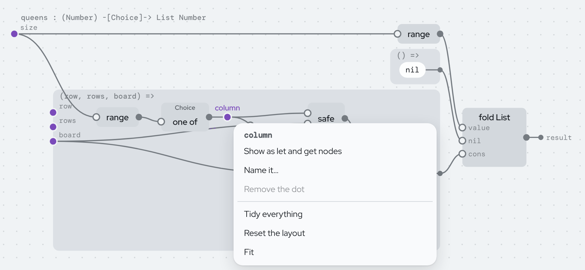
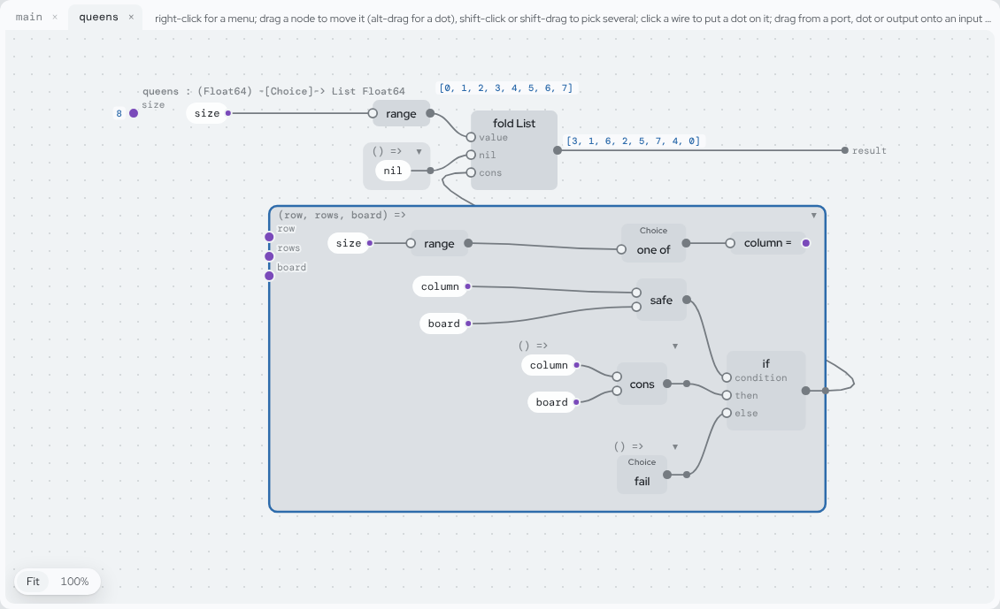
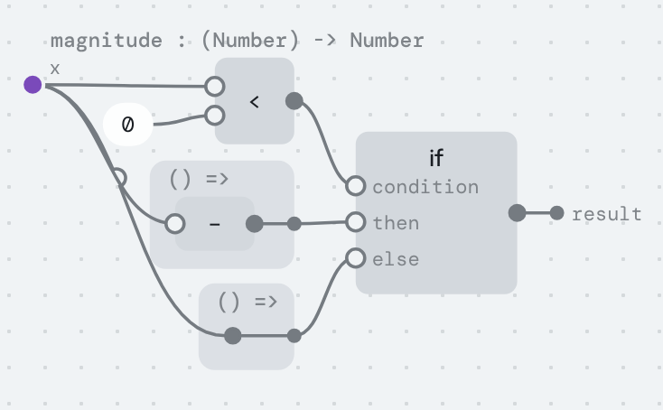
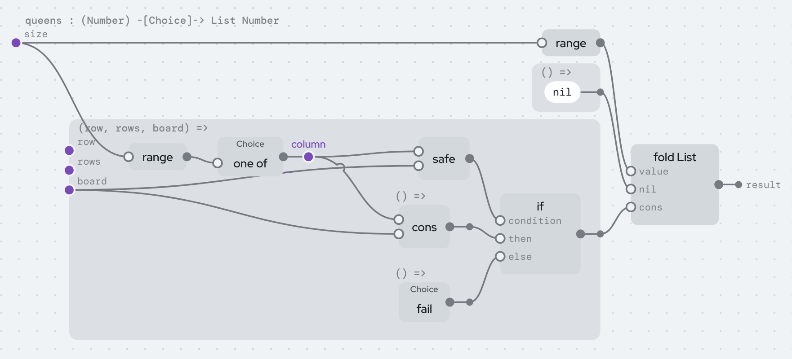
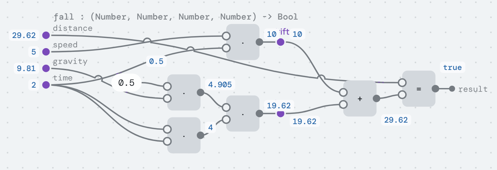
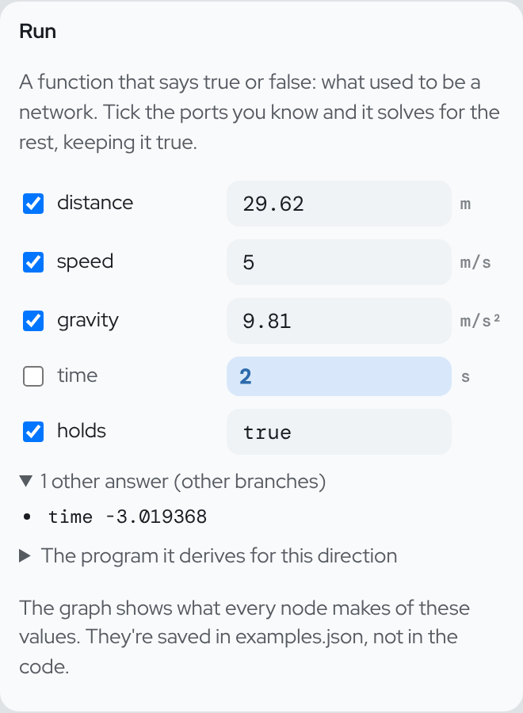
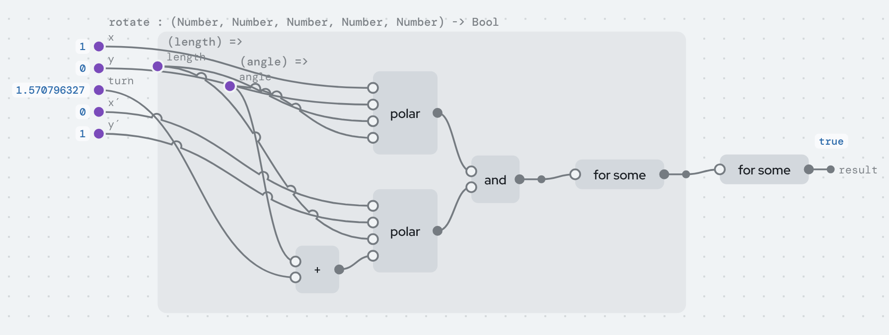
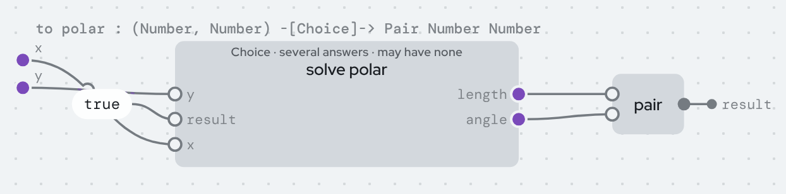
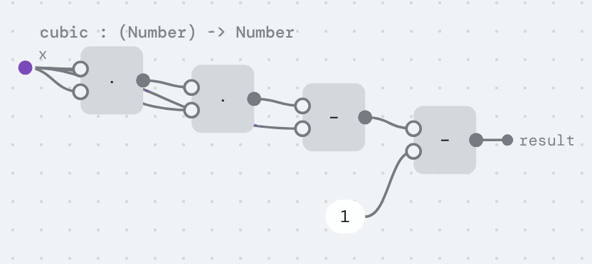
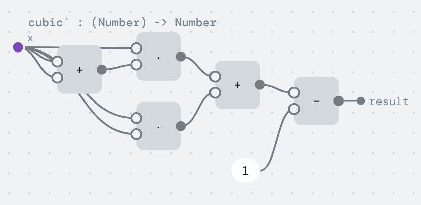

# A tutorial for the projectional language

This tutorial explains the language in three parts:

1. [For a five-year-old](#part-1-for-a-five-year-old): what this is, with
   no programming words at all.
2. [For programmers who haven't done functional programming](#part-2-for-programmers-who-havent-done-functional-programming):
   the six ideas the language takes from that world, in plain words.
3. [The language](#part-3-the-language): one idea at a time, each one in
   the editor.

Want to get your hands on the editor first? The [hands-on guide](GUIDE.md)
changes one small program step by step. [Learn](LEARN.md) helps you pick
where to start.

Many of these ideas were had by other people first, and some of the code
is adapted from theirs. [Credits](#credits) at the end says where each one
comes from.

---

## Before you start: the editor

Everything here can be tried in the editor:
https://ersagunkuruca.github.io/language-lab/.

The examples ship with it, in the *Programs* list on the left. This
tutorial uses *Numbers & physics*, *Insertion sort*, *Eight queens*,
*Calculus*, *Run backwards*, *Relations in programs* and the two shaders.
*+ New program* starts an empty one of your own.


The window is in panes:

- **Programs**, on the left: every program and its definitions.
- **The graph**, in the middle, with a tab for each definition you've
  opened.
- **The text**, below the graph: the same definition written out. *Blocks*
  is the one to read. *Steps*, *Nested* and *Lisp* are other ways of
  writing it.
- **Run**, on the right at the top.
- **The inspector**, below Run, with five tabs: *Definition* (it says
  *Selected* when something is picked), *Program*, *Checks*, *Files* and
  *Guide*.

The bar across the top switches between *Short names* and *Descriptive*,
and between three ways of writing arithmetic. It also has *Undo* and
*Redo*. Drag the gutters between panes to resize them.

Colour means something in only a few places. Blue is what's selected, and
values. Purple is dots. Amber is holes and refusals. Everything else is
grey.

*The screenshots are from the editor as it was on 2026-10-22. A few
details have moved since, but what they show still works.*

---

## Part 1: For a five-year-old

Imagine a big table covered in little machines.

Each machine has holes on its left, where you put things in. It has a
spout on its right, where something comes out. One machine adds two
numbers. One makes a number bigger. One looks at a picture and tells you
whether it's a cat.

You connect the machines with strings. A string goes from one machine's
spout to another machine's hole. Whatever comes out of the first goes into
the second. If you want the same thing to go to two places, the string
splits in two.

That's a program here: machines and strings.

There's nothing to type, so you can't make a typo. If you try to tie a
string to a hole where it doesn't fit, the string won't stick, and a
little note tells you why.

Every machine works backwards, too. A machine that turns "how fast and how
long" into "how far" can also be asked: "I went this far. How long did it
take?" And it figures it out.

Some holes can stay empty for now. That's fine. The machine knows what
kind of thing should go there. When you point at the hole, it shows you
only the things that fit.

Each machine has a sticker with its name. You can put on your own
stickers, in your own words. The machines don't care: they still do
exactly the same thing. Your friend can use their own stickers on the same
table.

---

## Part 2: For programmers who haven't done functional programming

You don't need to know Haskell or Lisp. You need six ideas, and the editor
shows each of them as a picture.

### 1. A program is values flowing through functions

In most languages, a program is a list of instructions that change
things: `x = 3; x = x + 1; print(x)`.

Here, a program describes how each value is made from other values: "the
discriminant is b·b minus 4·a·c". There's no `x = x + 1`, because nothing
changes once it's made.

That's why a program can be drawn. Every value is a node, and every use of
it is a wire.


### 2. Functions are values too

You can pass a function around like a number. `for each(list, action)`
takes a function, `action`, and calls it on every item.

In the editor, a function that hasn't been called yet is drawn as a
**frame**: a box with its inputs on the left edge and its result leaving
on the right.

### 3. A "let" just names a value so you can use it twice

`column = one of(range(size))` in the queens program doesn't store
anything anywhere. It means: this value, used in these two places.

In the editor that's a **dot** on a wire, with two wires coming out of it.

### 4. Data comes in cases

A list is either empty (`nil`), or an item followed by the rest of a list
(`cons(item, rest)`). A Boolean is `true` or `false`.

These are **data types**. Each case is a **variant**, and a variant can
have **fields**.

When you look inside a value like this, you say what to do in every case.
That's `match`. `if` is the same thing, for `true` and `false`.

### 5. No loops: you walk the data instead

There's no `for (i = 0; i < n; i++)`.

To do something to every item of a list, you say two things: what to do
for `nil`, and what to do for `cons(item, rest)` when you already have the
answer for `rest`. That's a **fold**.

Each step of a fold works on a smaller piece, so a fold always finishes.

A function can also call itself. The language works out whether that
finishes. If it can't tell, it says so in the function's type.

### 6. What a function does besides return a value is in its type

Printing, reading files, failing, giving several answers, and maybe never
finishing are called **effects**. They aren't hidden. They're listed in
the function's type:

```
queens : (Float64) -[Choice]-> List Float64
main   : () -[Console]-> Unit
```

Read `-[Choice]->` as "an arrow that may give several answers, or none".

You never write types. The editor works them out, and shows them when you
hover and in each frame's title.

That's all the functional programming you need.

---

## Part 3: The language

### 3.1 The program is the tree; names are stickers

There's no source text.

The program is stored as nodes, each with an id, in a file called
`code.json`. Everything else is kept in separate files: names
(`names.*.json`), comments (`comments.json`), where things sit on the
canvas (`layout.json`), and example inputs (`examples.json`).

The *Files* tab lists them. It also shows the program's **meaning hash**,
a fingerprint of what the program does.

What this buys you:

- **No syntax errors**, because there's no syntax.
- **No unknown names or typos.** A reference is an id you picked from a
  list.
- **Renaming is free.** It changes a names file, not the program. The
  meaning hash stays the same.
- **Names can clash without harm.** Name three inputs `k` and they show as
  `k₁`, `k₂` and `k₃`. Nothing is looked up by name, so one name never
  hides another.
- **Notation is personal.** Switching between `a · b`, `a * b` and
  `(* a b)`, or between *Short names* and *Descriptive*, changes only what
  you see.

**Try it.** Open *Numbers & physics*, then `discriminant`. Switch between
*Short names* and *Descriptive*, and between the three notations. Watch
the *Files* tab: `code.json` and the meaning hash never change.

### 3.2 Nodes and wires

A **node** works out a value. It can be a function call, an `if`, a
`match`, a `fold` or a `solve`.

A node's inputs are hollow circles on its left. Its output is the filled
circle on its right. A **wire** carries a value from an output to an
input.

There are no variable boxes. Every use of a value is a wire from where
the value comes from. So a value used twice visibly fans out. In
`discriminant` above, `linear coefficient` has two wires, because it's
used twice.

**Values on wires.** A small blue chip next to an output shows the value
it made the last time the definition ran on its example inputs. You set
those inputs in the *Run* pane.

A value isn't a name. A name is text you chose, and it lives in the names
file. A value is a result, and it changes when the inputs do.

Chips are placed where they don't cover anything. A chip with no room
shrinks to a dot. Hover over it to see the value.

**Gestures:**

- Drag from an output, or a dot, onto an input to use that value there.
- Drag an input's wire into empty space to remove it. The input becomes a
  hole.
- Drag a node to move it. It stays exactly where you put it, and nothing
  else moves. Alt-drag moves a dot.
- Shift-click or shift-drag to pick several nodes. Dragging one moves them
  all.
- *Fit* and *100%* zoom the canvas. It goes on forever in every direction.

**Right-click** anywhere in the graph to see what you can do there:

- On a hole: the palette, with a search box.
- On empty space: *Add a value here*, which makes a new dot holding a hole,
  for you to fill and wire in.
- On a node: open it, show it inline, put a dot on it, clear it, or
  *Change the function…*. That keeps a call's inputs and offers every
  function that takes them, so you can turn `·` into `+`.
- On a dot or port: *Show as let and get nodes* (see 3.3).

*Tidy everything* lays the whole graph out again, the same way every time.
Tidying only the picked nodes spaces just those out.

Where wires still cross, one hops over the other, like a bridge. Where a
wire runs under a node, its hidden stretch shows faintly on top, like a
tunnel. [NODE-EDITOR.md](../design/editor/NODE-EDITOR.md) has the
reasons.



### 3.3 Dots: where a value starts and branches

A **dot** is where a value starts and branches out to every place that
uses it. Two things are dots:

- **A function's inputs**, on its frame's left edge.
- **A let.** Click any wire to put a dot on it. Select the dot to give it
  a name. If you don't, it shows as `•1`, `•2` and so on, which is only a
  handle and is never stored. Drag from the dot to another input to share
  the value there.

There's no `let` node in the code. Removing a dot with one wire out puts
the value back on that wire.

A dot that nothing reads is a step done only for what it does, like each
`print` in `main`. Those dots are drawn hollow.

Sometimes a dot's wires run far across the graph. Right-click it and pick
*Show as let and get nodes*. The dot becomes a **let** node where the value
is made. Each place that uses it gets a small **get** node beside it, with
the same name, so no long wire is needed.

That's only a way of drawing it. The code doesn't change. *Show as wires*
turns it back.



### 3.4 Frames: functions not called yet

A **frame** is a function as a value. Its inputs are dots on its left.
What it gives back leaves on its right.

A whole definition is a frame too. Its title shows its name and the type
the editor worked out, like `queens : (Float64) -[Choice]-> List Float64`.

Frames nest. A node can't leave the frame its inputs come from: if you drag
it out, the frame grows to keep it inside.

### 3.5 Holes: the program is allowed to be unfinished

A **hole**, drawn `□`, is a value not filled in yet. It knows its type.

Select a hole and the inspector lists only the things that fit there:

- values in scope
- calls, which arrive with one hole per input
- constructors, numbers, text and functions
- "match …" and "fold …" for each value whose type has cases

A program with holes still runs, until it reaches one.

**Try it.** Open *Insertion sort*, then `insert`.

1. In the blocks, click the body of the `else` case of the `if`.
2. Press *Clear to a hole*. The hole needs a `List Float64`.
3. Look at the palette. It offers `items`, `tail`, `tail′`, `nil`,
   `cons(□, □)`, `append(□, □)`, `insert(□, □)`, `sort(□)` and other
   things that make lists. It doesn't offer `x` or `head`, because those
   are numbers.

That's the whole idea of "the editor prevents type errors": you can't pick
what doesn't fit. *Insertion sort* itself was written this way, with
palette picks only.

### 3.6 Writing your own program

- **+ New program** makes an empty program. Every edit is kept in the
  browser as you go.
- **Save file** and **Open file…**, in the *Program* tab, write and read
  the whole program as one file: code, names, comments and layout.
- A program has a **comment**, and so does each definition. Write it in
  the *Program* tab. Say what the program is, and whose code or ideas it
  builds on. A shader shows its comment above its picture. **Credits** in
  the top bar comes [here](#credits), to the language's own.
- **+ New definition** makes a function, a value, a data type or an
  effect. For a function, give its inputs. With no inputs, it's an action
  you can run.
- Select a case of a data type to add fields to it. You pick a field's
  type the way it's written: first what it is (Float64, Int, Text, Bool,
  a data type, or the type itself). If that type takes arguments, you
  pick each one the same way. So for a pair of a whole number and text,
  pick *Pair*, then *Int*, then *Text*.
- In a type with only one case, a field is also the function that reads
  it. The palette offers `pages(□)` for a chapter's page count, and
  `fst(□)` and `snd(□)` for a Pair. A type with several cases is taken
  apart with a match instead, since the field may not be there.
- The *Definition* tab renames a definition, adds, reorders and removes
  inputs, and deletes it. A new input gives every call a hole for it, so
  no call is ever missing an argument.
- *Pin this type*, in the same tab, means edits inside must keep the type.
- A definition from a published library is read-only. *Copy into my
  program* gives you your own version to change.
- **Copy** (Ctrl+C), **cut** (Ctrl+X) and **paste** (Ctrl+V on a hole) move
  whole parts, with their dots and names.
- **Show inline** draws a call as the body of the function it calls, right
  there. It's only a view: the code doesn't change.
- Double-click a call to open the function it calls.
- Select a built-in like `+` to see **how it's defined**: its equation, and
  every direction it can be run in.

### 3.7 Data types, `match`, `if`, records

A data type lists its cases. Each case can have fields:

```
type Shape
  | circle(radius: Float64)
  | rectangle(width: Float64, height: Float64)
```

A case used as a function builds a value: `circle(2)`.

The standard types `Bool`, `Unit`, `List a`, `Pair a b` and `Optional a`
are ordinary data types. They aren't built in.

Fields are ids, not names. So two libraries can both have a field called
`name`, and they never clash.

**`match`** looks at a value and has one case per variant. In the graph it's
an ordinary node. The value goes into its first input. Then there's one
frame per case, and that frame's inputs are the case's fields.

**`if`** is a match on `Bool`. It's drawn the same way, with inputs
labelled `condition`, `then` and `else`.



Two gestures make sure a match never misses a case:

- **Split by cases…**, on any part, replaces it with a match on a value you
  pick. You get one case per variant, each starting as a copy of what was
  there.
- **Add a case**, on a data type, adds the new case, with a hole, to
  *every* match and fold over that type.

So a missing case can't be written.

**Records.** A type with one case is a record. A field used as a function
reads it: `fst(p)`.

`set(field, record, value)` gives the record with one field changed. The
field can be a path: `set((p) ↦ p.home.city, ada, "Paris")`.

There's nothing new behind `set`. It's the field read, run backwards, with
the rest of the record given.

**Whole numbers and text.** `Int` is whole numbers, and it never overflows:
past 2²⁸ it switches to big integers. `Float64` is floating point. The two
don't mix unless you convert, with `as float64` or `whole part`.

Where there's no whole answer, there's no answer. `quotient` by zero
gives `Choice` (see 3.9), not a crash.

Text has `length`, `slice`, `split`, `join all`, `find` and more. An emoji
counts as one character.

### 3.8 Loops are folds

A **fold** is a match where each field that holds the same type also comes
with its result, already worked out.

In `insert`, the `cons(head, tail)` case also gets `tail′`. That's `x`
already inserted into `tail`:

?[insert, live: change x or items under Run and the result follows; tick result and untick items to run it backwards; click a part to see its type and what can replace it](index.html?embed&program=sort&def=insert)

`sort` is a fold too. Each item is inserted into the rest, which is
already sorted. This one is read-only. *Open in the editor* takes you to
the whole program.

?[sort, read-only](index.html?embed&readonly&program=sort&def=sort)

In the graph, a fold has the same shape as a match. The case frames just
have the extra inputs.

A fold always finishes. It also works on trees whose children are in a
list, like an HTML document or JSON. There, the folded value of the
children is the list of their results.

The eight queens program is a fold over the rows. For each row, it picks a
column, and keeps it only if it's safe.



**A function can call itself.** The checker looks at every chain of calls
that comes back to where it started. Along each one, some input must get
strictly smaller: a piece that a match took apart from it. (This method is
called size-change termination.)

That covers one input shrinking, inputs that swap places, functions that
call each other, and Ackermann-style orders.

Anything else gets the `Diverge` effect in its type, and so does
everything that calls it. `newton` in *Calculus* has `Diverge`, because
nothing in it gets smaller. `with fuel(100, …)` turns that into `Choice`:
it gives up after 100 steps.

**A data type can hold itself**, directly or through other types. Think of
a list's rest, a tree's branches, an outline item's `children: List Item`,
or two types that hold each other.

Two rules keep "smaller" honest:

- A type can't take itself as the input of a function in one of its own
  fields. Through `knot = wrap(f: knot → Float64)`, a function could call
  itself without any recursion the checker can see.
- Only functions can be recursive. `ones = cons(1, ones)` is refused, so
  all data is finite.

Whether to drop the first rule is an open question (BACKLOG L107).

### 3.9 Effects

A node that performs an effect carries a **badge**: a small word naming
the effect. These are the effects:

| effect | what it means | made by | removed by |
|---|---|---|---|
| `Choice` | may give several answers, or none | `one of(list)`, `fail()`, `value of(optional)`, running a function backwards | `first(action, fallback)`, `all(action)`, `count(action)`, `optional(action)` |
| `Abort` | stops, with a reason | `abort(reason)`, a missing file | a `match` with an `abort(reason)` case; at the top, the run ends with the reason |
| `Log` | debugging output | `log(line)` | a `match` with a `log(line)` case; at the top, standard error |
| `Console` | reads and prints | `print(text)`, `read line()` | the runtime |
| `Files` | reads and writes files | `read file`, `write file`, … | the runtime |
| `Random` | draws random numbers | `random()` | `seeded(seed, action)`, or a match; at the top, the world's randomness |
| `Time` | reads the clock | `now()` | a match (a test's fixed clock); at the top, the clock |
| `Wait` | pauses | `wait(milliseconds)` | a match; at the top, the runtime |
| `Network` | fetches over HTTP | `fetch text(url)` | the runtime |
| `Diverge` | might not finish | recursion the checker can't see ends | the runtime, or `with fuel(n, action)` |
| `Cells` | reads cells, makes cells and formulas | `cell(x)`, `formula(action)`, `read(c)` | the runtime (below) |
| `Update` | changes a cell | `write(c, x)` | the runtime |
| yours | what you declare | its operations | a `match` on them |

**Choice is the interesting one.** It does several jobs that other
languages do with separate features:

- **Search.** `queens` picks `one of(range(size))` for each row, and calls
  `fail()` if the pick isn't safe. There's no search code. `first` gives
  one board, `count` gives 92, and `all` gives every board.
- **Absence.** There's no `null`. "Might not have a value" is `Choice` in
  the type, and something has to handle it before `main`. When you need to
  *keep* an absent value in a list or a record, use `Optional`: `none` or
  `some(value)`, a case you match on.
- **Filtering.** `keep(list, test)` is just
  `all(() => item = one of(list); if test(item) then item else fail())`.
- **Several answers from running backwards.** See 3.10.

**Abort is failure with a reason**, and gives only one answer. `read file`
aborts with "no such file: notes.txt". An ordinary
`match … | abort(why) → …` catches it.

A rule of thumb:

- `Choice` for search and "no answer"
- `Abort` for errors someone should read
- `Optional` to keep an absence in data

**You can define your own effects.** An effect is declared like a data
type, but its cases are operations:
`effect Ask = ask(question: Text) returns Float64`.

Calling `ask("width")` performs it. Handling it is a `match` on the
computation that performs it, with one case per operation:

```
handle width() + height()
  ask(question) → if question = "width" then 30 else 12
```

So handlers need no new kind of node. A handler is a match, an operation
is a case, and performing is calling. The blocks write such a match as
`handle`.

The **Effects** example is this program, with `Abort` handled too. To
declare your own effect, use *+ New definition*, then *Effect*.

**Two safety rules:**

- A definition's own value must be pure. Anything that acts is an
  *action*: a function with no inputs, like the `() =>` frames that
  handlers take.
- The world (`Console`, `Files`) can't be touched while a `Choice` is
  open. Otherwise a search could print something on a path it later
  abandons. Handle the search first, then act on its result.

Effects combine with no extra machinery. `map` has the type
`(List a, (a) -[e]-> b) -[e]-> List b`. Whatever effects the function you
pass in has (`e`), `map` has too. There's no separate `map` for functions
with effects.

**Try it.** Open *Eight queens*, then `main`, and press *Run main*. You
get the first solution for 8, the count (92), and all four solutions for 6.

**Cells: values that change.** One more effect is how a page reacts to
clicks, the way Solid.js does it:

- `count = cell(0)` makes a cell.
- `read(count)` reads it.
- `write(count, 1)` changes it. That's the effect `Update`. Like printing,
  it can't happen inside a search.

A page is a value whose changing parts are actions, like
`() => show(read(count))`. The runtime notes which cells each action read.
When a cell changes, it runs again exactly the actions that read it.

**Formulas: values worked out when asked.**
`formula(() => read(count) * 2)` is a cell worked out from other cells. It
runs the first time something reads it, and again only after a cell it
read has changed.

Because a formula runs only when it's read, and only once, data can go on
forever. A continued fraction whose rest is a formula works out its terms
as you ask for them.

Both run live on the
[Cells page](https://ersagunkuruca.github.io/language-lab/reactive.html).
LANGUAGE.md, "Cells", has the details.

### 3.10 Running any function backwards

Every function has **ports**: its inputs and its result.

Running it forwards means giving it the inputs and asking for the result.
But you can give it any of its ports, and ask for the others.

The *Run* pane lists the ports of the definition you're looking at, each
with a tick box. Ticked ports are the ones you give. The others are worked
out. Which ones are ticked is kept in `layout.json`, not in the code, so
flipping them changes the direction, not the program.

This isn't only for arithmetic. Every node has a backwards reading
([BACKWARDS.md](../language/BACKWARDS.md) has the table):

- a constructor takes its value apart
- an `if` becomes a choice between its cases
- a fold becomes an unfold
- `join text` tries every way to cut the text

Some examples from *Run backwards*:

- `magnitude` (the `if` above), run backwards from 5, gives −5 and 5.
- `show numbers` is a printer written as a fold. Run backwards on
  `"10 20 30"`, it gives `[10, 20, 30]`. Nobody wrote a parser.
- `greet` builds `"hello, " ++ name`. Run backwards on `"hello, Ada"`, it
  finds `Ada`.
- `map(square, list) = [4, 9]`, run backwards, gives four lists.

Some things only run forwards: `print`, `floor`, and comparisons that
would have to produce a number. When that happens, the checker or the
search says so instead of guessing.

**A function that says true or false is a set of equations.** `fall` has
four inputs:



Each `=` in it is an equation. `and` puts several together. A dot on a
wire, like `drift` or `drop`, is just a name for part of an equation.

Run it with *holds* ticked and set to `true`. It solves for whichever
ports you left unticked, keeping the equations true.

Give it `distance` and ask for `time`. Thrown down at 5 m/s, a fall of
29.62 m takes 2 s. The other root, about −3.02 s, is listed as another
answer. *The program it derives for this direction* shows the quadratic
formula the solver worked out.



Two more words make true-or-false functions as expressive as wiring:

- **`for some`** names a value that isn't an input.
  `rotate(x, y, turn, x′, y′)` says: for some `length` and `angle`,
  `polar(x, y, length, angle)` and `polar(x′, y′, length, angle + turn)`.
- **`hence`** adds something that follows from what came before. `polar`
  says `x = length · cos(angle)` and `y = length · sin(angle)`, hence
  `x² + y² = length²`. That extra fact gives the solver a way in: from `x`
  and `y`, it finds `length` with a square root, with no search. It
  doesn't count as an extra condition.



**Units are part of the type.** Put `m` on `distance` and `m/s²` on
`gravity`, and the rest is worked out: `period` comes out in seconds, and
`drift` and `drop` in metres. To set a unit, select an input or a number;
*Unit* shows chips to pick from.

An edit that would add metres to seconds is refused, like any other type
error. A plain number has no unit. `9.81 m/s²` carries its unit.

**`=` on numbers allows a tiny difference.** Two numbers are equal when
they agree to within one part in a billion. So `0.1 + 0.2` equals `0.3`.
That's what a wire between two quantities should mean, and it's why `fall`
can be solved and then checked.

**Solve nodes** do the same thing inside a program (see *Relations in
programs*). The ports you give it are its inputs. The ones it solves for
come out on its right, all from the same solution.



Its effect depends on the direction. If there's always exactly one answer,
like the missing number in a sum, it's pure. If there may be several, or
none, it's `Choice`.

For example, `square` read backwards (`x · x = y`) gives both roots of 9
under `all`, and none for −1. The positive root comes first, so `first`
gives 3. That's the same `Choice` the queens use.

### 3.11 Calculus on real functions

`derivative(f)` reads a function's graph and builds its derivative, as
another function.

*Calculus* has `cubic(x) = x·x·x − x − 1`. Next to it in the list is
`cubic′`, which was generated from it. It applies the chain rule at every
node. Each operation's slopes come from the same table that runs it
forwards and backwards.




It works through lets, calls of other definitions (each gets its own
generated derivative), `if` and `match` (each case is differentiated), and
folds. A fold carries value-and-slope pairs: that's forward-mode automatic
differentiation, written in the language itself.

Where it can't read a slope, as through `floor`, the derivative fails
there, so its type has `Choice`. When the function is written right where
`derivative` is applied, and every slope can be read, the checker knows
the derivative fails only where the function does, and drops the
`Choice`.

**That's how the ray marcher gets its normals.** Its points are `Vec`s.
`shade` asks for `unit(gradient((q) ↦ scene(q, time))(p))`. `gradient` is
the slope of the scene along x, y and z, with time held still, as one Vec.

There's no derivative code in the program. Change `scene`, and the normals
follow. For the GPU, the compiler generates the gradient's code before it
writes the shader, so the shader gets exact slopes as plain arithmetic.

The other half of calculus is running backwards. `zeros of cubic` is
`cubic` run backwards from 0. `zeros of x² − 2` gives both `±1.414…`,
where Newton's method would find only one.

### 3.12 The errors you can't make

Every edit is checked before it happens. If the result has an error the
program didn't have before, the edit is refused, and the status line says
why.

The editor also tells you ahead of time. While you drag a wire, the inputs
you can reach light up, and the others say why not.

| error | status | why |
|---|---|---|
| syntax | impossible | there is no text |
| unknown name, typo | impossible | references are ids picked from a list |
| name clash, shadowing, capture | impossible | binders are ids; equal names get a subscript on screen |
| wrong number of arguments | prevented | a call is made with one hole per input; adding an input adds a hole to every call |
| type mismatch | prevented | holes only offer what fits; edits that add one are refused |
| unit mismatch | prevented | units are part of `Float64`'s type |
| missing case | prevented | cases come from the type; *Add a case* adds hole cases everywhere |
| null / undefined | impossible | there is no null; absence is `Choice` or `Optional` |
| integer overflow | impossible | `Int` is unbounded |
| errors without a reason | checked | `Abort` carries one; your own effects carry typed ones |
| unhandled effect | checked | effects are in types; `main` can't keep `Choice` |
| side effects on an abandoned search | checked | the world can't be touched while a `Choice` is open |
| comparing functions | checked | `equal` needs plain data |
| non-termination | inferred | it shows up as `Diverge` in the type |
| unfinished program | allowed | holes have types; it runs until it reaches one |
| `sqrt` of a negative, `÷ 0` on `Float64` | runtime | `Float64` follows IEEE (NaN, Infinity); `Int` division by zero has no answer |
| logic errors | not prevented | running backwards gives round-trip laws to test against |

The *Checks* tab lists these live for whatever program is open.
[LANGUAGE.md](../language/LANGUAGE.md) has the full table, with the test
that shows each row.

### 3.13 Libraries, and how it runs

**Libraries are named by what's in them.** `map`, `keep`, `reverse`,
`for each` and the rest of the standard library are published. Each
definition's id is a hash of what it is. So a reference to `map` says
exactly which `map`, forever, and there are no import statements.

Two people who publish the same function get the same hash, so their
copies are one. Published code can be opened and read, but not edited.

A **pin** freezes a definition's type. Then an edit that would change it
is reported at the definition, not at some caller far away.

**A program runs three ways:**

- **The evaluator**, which *Run* uses. It has no stack limit: summing a
  million numbers by recursion works.
- **The relational interpreter**, which runs anything backwards.
- **The compiler** ([COMPILER.md](../design/targets/COMPILER.md)), which
  turns a program into JavaScript, WebAssembly, C or a GPU shader. Eight
  queens runs about 600× faster compiled, and its search becomes the
  backtracking loop you'd write by hand. Compiled programs are tested to
  print exactly what the evaluator prints.

[RUNNING.md](RUNNING.md) has every way a program runs.

**Some programs are pictures.** If a program has a `colour` of
`(x, y, time)`, or a `red`, a `green` and a `blue`, it's drawn above *Run*.
The compiler turns it into a GPU shader, and the browser draws it every
frame with WebGPU. Edit any definition it uses, and the picture is drawn
again.

Without WebGPU, it's drawn on the CPU, smaller. When a function can't go
to the GPU (because it uses text, say), the picture says why.

**Try it.** Open *Shader: ray marching* and change a number in `sky`.

**Data can be stored differently from how it's written.** A proof of
concept writes `factorial` on counting numbers built from `zero` and
`succ`, and runs it on ordinary binary numbers, through a rewrite the
definition never mentions. It isn't in the editor yet.
[NUMBERS.md](../design/numbers/NUMBERS.md) has how, and how much of it is
built.

### 3.14 The words, in one place

These are the words the editor's *Guide* tab uses, one word per thing:

| word | what it is |
|---|---|
| node | something that works out a value: a call, an if, a match, a fold, a solve |
| wire | carries a value from an output (or dot) to an input |
| dot | where a value starts and branches: an input of a function, or a let |
| frame | a function not called yet: inputs on the left, result on the right |
| hole | a value not filled in yet, with a type |
| badge | the effects a node has, or the effect it handles |
| solve | any function run backwards: you give some ports, it works out the rest |

---

## Where this lives

- This file is `docs/learn/TUTORIAL.md`. The site build turns it into
  `tutorial.html`, which [Learn](LEARN.md) links to.
- The language reference is [LANGUAGE.md](../language/LANGUAGE.md).
  Running backwards is [BACKWARDS.md](../language/BACKWARDS.md). Numbers
  and how data is stored are in [NUMBERS.md](../design/numbers/NUMBERS.md).
- What's still confusing is in [CONFUSING.md](../design/CONFUSING.md), and
  what's next is in [BACKLOG.md](../../BACKLOG.md). Every document is in
  [the docs index](../README.md).
- The screenshots are in `docs/learn/tutorial/`.

## Credits

The ideas are mostly Ersagun's, but many were had by others first, and the
language borrows freely:

- content-addressed definitions from Unison
- typed holes from Hazel
- effect handlers from Koka and OCaml 5
- `Choice` from Verse
- running functions backwards from Prolog and miniKanren, whose search
  `relate.ts` adapts
- fusion from Wadler, and from Gill, Launchbury and Peyton Jones
- continued-fraction arithmetic from Gosper
- cells from Solid.js
- reroute dots from Blender

The *Shader: ray marching* example uses John C. Hart's sphere tracing, and
Inigo Quilez's torus, smooth minimum and soft shadow formulas. Each
definition's comment says so.

The example programs *wc*, *Insertion sort* and *Eight queens* are
classics: Unix `wc`, the textbook sort, and Bezzel's puzzle.

The full list, feature by feature, saying what's an influence, what's
prior work and what's adapted code, with the rule for crediting new work,
is [CREDITS.md](https://github.com/ersagunkuruca/language-lab/blob/main/docs/language/CREDITS.md).
