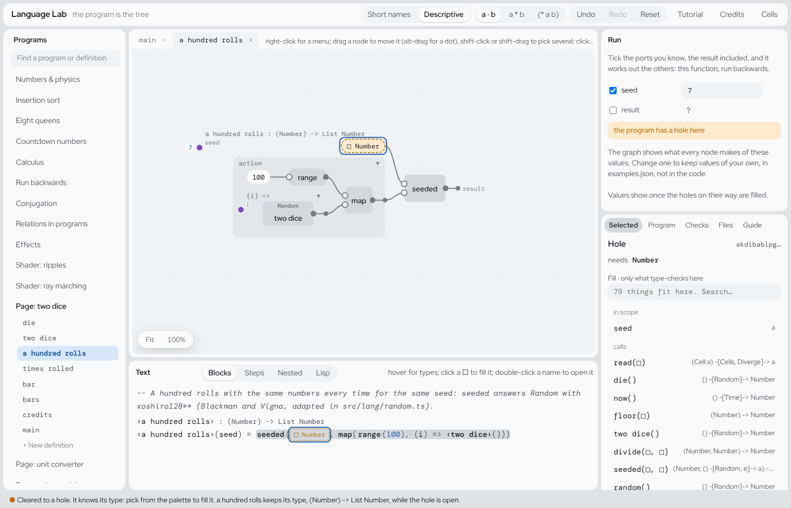
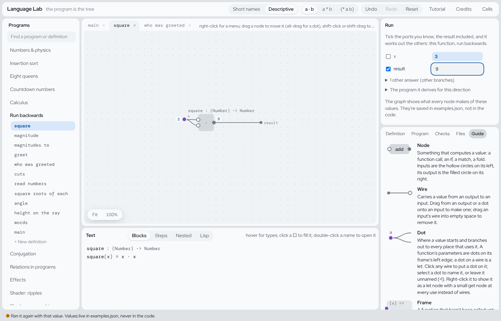

# A hands-on guide to the editor and the language

This is a tour you do with the editor open:
https://ersagunkuruca.github.io/language-lab/. It starts from one small
program, *Page: two dice*, and changes it with real edits. Each section is
short and ends with one thing to try. Words are explained the first time
they come up, and there's a list of them at the end.

[TUTORIAL.md](TUTORIAL.md) is the longer reference: the ideas behind the
language and the list of what's still confusing. [LANGUAGE.md](LANGUAGE.md)
is the full description. Start here; go there when you want the why.

*Written on 2026-10-24 against `main` at #397. Every step below was done
in the editor, in a browser, before it was written down.*

---

## 1. What you're looking at

Open the editor and pick **Page: two dice** in the **Programs** list on
the left. Under the program's name are its **definitions**: `die`,
`two dice`, `a hundred rolls`, `times rolled`, `bar`, `bars`, `credits`,
`main`. A definition is a named piece of the program, usually a function.


The window has four parts:

- **Programs** (left): the programs and their definitions. Click one to
  open it.
- **The graph** (middle top): the definition you opened, drawn as boxes
  (**nodes**) joined by **wires**. Data flows left to right.
- **Text** (middle bottom): the same definition as text. **Blocks** is the
  view to read; the other three (Steps, Nested, Lisp) are older ways of
  writing the same thing.
- **Run** (right top) and the **inspector** (right bottom). Run runs
  things. The inspector shows whatever you selected, and has tabs:
  Program, Checks, Files and Guide.

The graph and the text are two drawings of one thing. There's no source
file underneath: the program is a tree of parts, each with an id, and both
views draw that tree. That's why you can't make a typo or a syntax error:
you never type the program, you pick its parts.

**Try it:** click **Roll** a few times on the page in the Run pane. Then
click **Roll 100 with seed 7** twice and watch the bars.

## 2. Reading one definition, two ways

Click **die** in the list. The Blocks text says:

```
die : () -[Random]-> Number
die() = floor(random() · 6) + 1
```

The first line is the **type**: what goes in, what comes out, and what
else the function does along the way (section 4). The second line is the
body: a random number from 0 up to (not including) 1, times 6, rounded
down, plus 1.

In the graph the same body is boxes: `random` feeds `·` with `6`, that
feeds `floor`, that feeds `+` with `1`, and the last wire goes to `result`
on the right. A small grey word above a box, like **Random**, is a
**badge**: it says that box does something besides compute a value.

Things to know while reading:

- **Hover** over any part of the Blocks text to see its type.
- **Double-click** a name (`two dice` inside `a hundred rolls`, say) to
  open that definition. **← main** at the top takes you back.
- **Click** a part to select it. The inspector then says what it is and
  what you can do with it.
- Names in `‹…›` are names with spaces in them: `‹two dice›` is one name.

**Try it:** open `two dice` and `a hundred rolls` and read each in both
views. In `a hundred rolls`, find the `seed` in the graph: an input is a
purple **dot** on the left edge, and every place that uses it is a wire
from that dot.

## 3. Changing a value: holes and the palette

To change part of a program, you take the part out and put another one in.
Taking it out leaves a **hole**, drawn `□`. A hole knows the type of what
belongs there, and the inspector lists only things that fit: the
**palette**.

Let's make the "Roll 100" button use a random seed instead of 7. Open
**main** and find, in the Blocks text, the line

```
write(rolls, append(‹a hundred rolls›(7), read(rolls)))
```

1. Click the `7`. The inspector says **Literal** (a written-out value) of
   type `Number`.
2. Press **Delete** (or **Clear to a hole** in the inspector). The `7`
   becomes `□Number`, and the palette opens on the right.
3. Type `die` in the palette's search and click `die()`.



The status line at the bottom says *Filled with die(). No holes left in
this definition.* The page runs again: each click on "Roll 100 with
seed 7" now takes a die roll as its seed, so you get one of six different
hundreds. (The button's label still says "seed 7": that's just text, and
you can change it the same way: click it and type in the inspector.)

The palette groups what fits: **in scope** (inputs and names you can
reach from here), **calls** (functions, each arriving with a hole per
input), **constructors** and **literals**. You can also type a value
(`3`, `"hi"`, `[1, 2]`) or a short sum (`x + 1`).

**Undo** in the top bar takes back any edit, one step at a time.

**Try it:** put `7` back with Undo. Then do the edit again, but pick
`two dice()` instead of `die()`.

## 4. Reading a type

Every definition's first line is its type. Read the arrow as "takes …,
gives …":

| type | read it as |
|---|---|
| `die : () -[Random]-> Number` | takes nothing, gives a Number, and uses **Random** on the way |
| `a hundred rolls : (Number) -> List Number` | takes a Number, gives a list of Numbers, and does nothing else |
| `times rolled : (List a, a) -> Int` | takes a list of anything and one more of the same kind, gives a whole number |
| `main : () -[Cells, Time]-> Html` | takes nothing, gives a page, and uses cells and the clock |

- What's between `-[` and `]->` are the function's **effects**: things it
  does besides giving back a value. A plain `->` means none. Section 5 is
  about them.
- A lowercase letter like `a` means "any type, as long as it's the same
  everywhere `a` appears". `times rolled` counts how many items equal the
  one you give, so it works on lists of numbers, of text, of anything.
- Nobody wrote these types. The editor works them out from the body and
  updates them as you edit.

**Try it:** open `times rolled`, then `bar`, and say each type out loud
before hovering its parts.

## 5. Effects and handlers: the dice and the clock

An **effect** is something a function asks for while it runs: a random
number, the time, a line printed. The function only asks; something
outside it answers. That something is a **handler**.

`die` asks for a random number with `random()`. Who answers? It depends on
where `die` is called:

- **Nobody, so the world answers.** Open `die` and press **Run die** in
  the Run pane: a fresh number each time, from the browser's randomness.
- **`seeded` answers.** `a hundred rolls` is
  `seeded(seed, map(range(100), (i) => ‹two dice›()))`. Everything inside
  `seeded` gets its random numbers from the seed, so the same seed gives
  the same hundred rolls every time. That's why `a hundred rolls` has no
  `Random` in its type: the asking happens inside, and the answer comes
  from inside too.
- **You answer.** A handler is written like a `match`, with one line per
  question the effect can ask (its **operations**).

Make a loaded die that always rolls 6:

1. Under the definitions, click **+ New definition**. Name it
   `loaded die`, leave inputs empty, and press **Create**.
2. Its body is a hole. Type `handle` in the palette and pick
   **handle Random in □**.
3. The first hole is what to run: pick `die()`.
4. The other hole is the answer to `random`: type `0.99` and press Enter.


```
loaded die : () -> Number
loaded die() =
  handle die()
    random → 0.99
```

Press **Run loaded die**: always 6. Its type says `() -> Number`, no
Random, because the handler answered every question.

**The clock** is the effect `Time`, with `now()`. In `main`, the status
line reads `now()`, so the page reads the clock and that line runs again
every frame: it counts the seconds since the last roll.

**This is what went wrong with die() as a seed** inside `a hundred rolls`.
In `seeded(die(), …)`, the `die()` is rolled *before* `seeded` starts, so
`seeded` doesn't answer it. The function would gain `Random` in its type,
and the editor refuses edits that change a type while it is holding it
(section 9). Calling it from `main` with `die()`, as in section 3, works,
because a button may use Random: the Roll button already does.

The **Effects** program has an effect declared from scratch (`Ask`) and
two handlers. Run its `main`: `360 · can't: nobody to share with`.

**Try it:** open `Effects` → `area` and press its Run. It tells you that
nothing answers Ask. Then read `main` to see who does.

## 6. Choice: search without writing a search

`Choice` is the effect of "pick one of these", where the program may also
say "this pick is no good" (`fail()`). Open **Eight queens** → `queens`:

```
column = ‹one of›(range(size))
if safe(column, board) then cons(column, board) else fail()
```

For each row it picks any column, and gives up on that pick if a queen
could take another. There's no loop that tries the columns: the handler
does that. Open `main`:

- `first(queens(8), else nil)`: the first board that works.
- `count(queens(8))`: how many boards work (92).
- `all(queens(6))`: every board, as a list.

Same `queens`, three handlers, three answers. Press **Run main**.

Choice is also how the language says "there might be no answer": there is
no `null`. Something has to handle the Choice (`first`, `all`, `count`,
`optional`) before you can use the answer.

**Try it:** in `main`, change the `6` in `all(queens(6))` to `5`
(click it, Delete, type `5`, Enter) and run again: ten boards. The
heading above them still says 6, because that's a separate piece of text.

## 7. Running a function backwards

Every function can run backwards: give it the answer and it finds the
inputs. Open **Run backwards** → `square` (`square(x) = x · x`).

The Run pane lists the function's **ports**: its input `x` and its
`result`, each with a tick box. Ticked ports are the ones you give.

1. Type `3` next to `x` and press Enter: result `9`.
2. Tick **result**, untick **x**, and type `9` next to result: `x` is `3`,
   with **1 other answer** under it (that's −3).



Now `greet` (`greet(name) = "hello, " ++ name`). Untick **name**, tick
**result**, and type `"hello, Ada"`, with the quotes because it's text:
`name` is `"Ada"`. Nobody wrote an "un-greet" function: the editor
derives it.

**Try it:** run `magnitude` backwards from `5`.

## 8. Pages

A **page** is a definition that gives `Html`. `main` in two dice is one.
Its parts:

- `rolls = cell(nil)`: a **cell**, a value that can change. It starts
  as the empty list.
- `read(rolls)` reads it; `write(rolls, …)` changes it.
- `button("Roll", (event) => …)`: a button, and what to do when it's
  clicked. The part after `=>` is a function the page calls on each click,
  so it may use Random and write cells.
- Any part that reads a cell runs again when the cell changes. That's how
  the bars update. Nothing else needs to.
- `styled(…)`, `p(…)`, `h1(…)`, `words(…)` are HTML elements, each a
  function.

A page's `main` doesn't print: the Run pane *is* the page. **Restart**
runs it from scratch, and **Open in a tab** shows it on its own.

To add a button, copy an existing one: click the `(` right after `named`
on the `"hundred"` button and press Ctrl+C, then paste it into a hole in
the list. A list has no "add an item" yet, so making that hole is a
detour: click the list's `[`, cut it with Ctrl+X, fill the hole with
`append(□, □)`, paste the list back into the first □, then fill the
second with `cons(□, □)` and its last □ with `nil`. That leaves one □ for
the new button.

**Try it:** change the `"Roll"` label to `"Throw"` and click it on the
page.

## 9. When the editor says no

Every edit is checked before it happens. When an edit would break the
program, nothing changes and the status line says **Refused:** and why.

The one you're most likely to meet: when you clear part of a finished
definition, the editor **holds** that definition's type until the hole is
filled, so the rest of the program keeps working meanwhile. A fill that
would change the type is refused, even one the palette offered. That's
the die-as-seed case:

> Refused: a hundred rolls is pinned to (Number) -> List Number, and this
> makes it (a) -[Random]-> List Number. Nothing changed.

Two ways on:

- Make the change somewhere that's allowed to have the effect: in the
  caller, as in section 3.
- Or let the type change: click the definition's name in the Blocks text,
  and in the inspector press **Let it loosen**. Then fill the hole again.

A type can also be **pinned** on purpose, in the inspector of a definition
(**Pin this type**): then it's a promise, and only Unpin lets it change.

(The message says "pinned" when it is only held, and the palette shouldn't
offer what will be refused. Both are known editor bugs and are on the
backlog.)

**Try it:** in `a hundred rolls`, clear `seed` and pick `die()` to see
the refusal. Then Let it loosen, pick `die()` again, and read the new
type. Undo twice to get back.

## 10. Saving, and getting back

- **Every edit is kept in this browser** as you make it. Close the tab,
  come back, and your changes are there.
- **Undo** and **Redo** step through your edits.
- **Reset** puts an example back as it shipped. It can be undone too.
- **Program** tab → **Save file** downloads the whole program (code,
  names, comments, layout) as one file. **Open file…** loads one back.
  **New program** starts an empty one.

Edits live in this browser only, so another browser or a cleared
browser won't have them. Save a file of anything you want to keep.

**Try it:** Save file on your changed two dice, Reset it, then Open file
to get your version back.

## Words used here

| word | meaning |
|---|---|
| definition | a named part of a program, usually a function |
| node, wire | a box in the graph and the line carrying a value between boxes |
| dot | where a value starts: an input, or a named value inside a body |
| hole `□` | a part not filled in yet; it knows its type |
| palette | the list of things that fit a hole |
| type | what goes in, what comes out, and the effects |
| `a`, `b` in a type | any type, the same one each time it appears |
| effect | something a function asks for: Random, Time, Choice, Console… |
| handler | what answers an effect: `seeded`, `first`, a `handle` match, or the world |
| badge | the small word over a node naming its effect |
| cell | a value that can change; a page re-runs what read it |
| held, pinned | a type the editor keeps fixed while you edit, or that you fixed on purpose |
| port | an input or the result, in the Run pane's backwards runs |

## Credits

This guide is our own and borrows no teaching material. The programs it
uses credit their sources on screen and in [CREDITS.md](CREDITS.md):
the seeded rolls are xoshiro128** by David Blackman and Sebastiano Vigna
(adapted code); the clock that runs each frame follows Fran (Elliott and
Hudak) and Elm (prior art); effects with handlers you choose follow Koka
and Eff (prior art); the eight queens puzzle is Max Bezzel's (1848), and
search by choice and failure follows Prolog and Verse (prior art).
