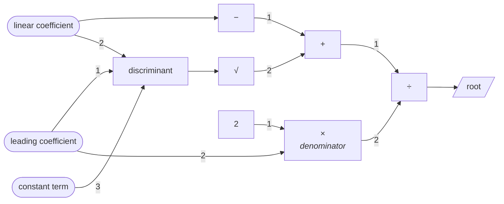

# projectional: the program is the tree

A small prototype of a language whose source of truth is an AST, not text.
Identifiers are opaque IDs, names are free text kept in a separate table, and
everything you normally fight about (formatting, operator symbols, infix vs
prefix, naming style, whether to nest or use temporaries) is a *view* chosen
per person. No parser exists, on purpose.

New here? Start with [TUTORIAL.md](TUTORIAL.md): an introduction for
non-programmers and for people new to functional programming, a tour of the
language in the editor, and a list of what's confusing or could be simpler.
For a candid review of the whole project (holes, what's achievable, and a
roadmap towards real programs, shaders, websites and apps), see
[REVIEW.md](REVIEW.md). What comes next is in [ROADMAP.md](ROADMAP.md), and
the design ideas we've discussed, with the current answer to each, are in
[NOTES.md](NOTES.md).

```sh
npm run demo   # walks through everything below (Node >= 22.18, no dependencies;
               # running backwards uses the solver in ../invertible)
npm test
```

## The core data model

`code.json` is a flat map of nodes keyed by random ID. That's the whole
semantic program. The expression node kinds (`src/model.ts`; holes, data
types and `solve` are covered in LANGUAGE.md):

| kind      | fields                 | notes                                                        |
|-----------|------------------------|--------------------------------------------------------------|
| `lit`     | `value`                | number or string                                             |
| `binder`  | (none)                 | the *identity* of a variable. It has no name.                |
| `ref`     | `target`               | points at a binder, def or builtin **by id**                 |
| `call`    | `fn`, `args[]`         | operators are just calls; `+` is a name, not syntax          |
| `lambda`  | `params[]`, `body`     | params are binder ids                                        |
| `def`     | `body` (or `null`)     | top-level definition; `null` body = extern                  |
| `builtin` | `op`                   | `builtin.add` etc. Referenced exactly like user defs         |

There is no `let`: `((d) => body)(x)` *is* a let, and the let view shows it
as one. There are no modules, imports or files inside the code: a def refers
to what it needs by id, and published code's id is its content hash, so a
module is just published nodes plus side tables (LANGUAGE.md, "Signatures
and modules").

Everything else is a side table keyed by node id, each in its own file:

```
examples/quadratic/
  code.json                 the tree. The only thing a compiler would read.
  names.short.json          Δ, x₊, a, b, c
  names.descriptive.json    discriminant, root, "leading coefficient", ...
  comments.json             notes attached to nodes, not to lines
  hints.json                strategy / precision / inlining notes
styles/
  math.json  plain.json  lisp.json  graph.json    a person's view + notation
```

Names layers stack (`short` then `descriptive` overrides), so a team can
share a vocabulary and a person can override bits of it. A **style** picks
the view and the notation for each function: glyph (`*`, `·`, `×`), fixity,
precedence, associativity. Precedence is part of *your notation*, not of the
language, so parentheses are computed at render time (`src/render/expr.ts`).

## What the demo shows

**One tree, two shapes.** Ersagun's example, stored once in
`examples/compose/code.json`:

```
nested:  a = ((d) => b(c(d, e(f, d))))(g(h))

let:     d = g(h)
         t1 = e(f, d)
         t2 = c(d, t1)
         a = b(t2)

lisp:    (define a ((λ (d) (b (c d (e f d)))) (g h)))
```

The temporaries `t1`, `t2` have no existence in the code. If you give the
node a name in a names layer, the let view uses it (see `denominator` below),
so naming an intermediate step works like a comment.

**One code.json, several people.** The same quadratic program:

```
short names, math style, nested:

  -- b² − 4·a·c; negative means no real roots
  Δ = (a, b, c) => b · b − 4 · a · c
  x₊ = (a, b, c) => (−b + (√Δ(a, b, c))[1]) / (2 · a)
    [1] NaN when Δ is negative

descriptive names, ASCII operators, let view:

  -- ‹linear coefficient›² − 4·‹leading coefficient›·‹constant term›; negative means no real roots
  discriminant(‹leading coefficient›, ‹linear coefficient›, ‹constant term›):
    t1 = ‹linear coefficient› * ‹linear coefficient›
    t2 = 4 * ‹leading coefficient›
    t3 = t2 * ‹constant term›
    return t1 - t3

  root(‹leading coefficient›, ‹linear coefficient›, ‹constant term›):
    t1 = -‹linear coefficient›
    t2 = discriminant(‹leading coefficient›, ‹linear coefficient›, ‹constant term›)
    t3 = sqrt(t2)   -- NaN when discriminant is negative
    t4 = t1 + t3
    denominator = 2 * ‹leading coefficient›
    return t4 / denominator
```

The `‹ ›` around multi-word names is a choice of the `plain` style (so it
still reads in a terminal); a real editor would just show a chip.

Comments are structured too: `{3fa2c19e}` inside comment text is a reference
to a node and is shown with its current name. That's why the discriminant's
comment says `b² − 4·a·c` in one view and spells out the coefficients in the
other, and it keeps up with renames.

The node view (Mermaid, so GitHub draws it). Variables are wires that fan out:



**Rename is not an edit to the program.** Renaming a binder produces a new
names table. `code.json` is byte-for-byte unchanged, the semantic hash is
unchanged, and evaluation is unchanged (the interpreter's environment is
keyed by binder id, `src/lang/run.ts`).

**Collisions are a display problem.** Name all three parameters `k` and
nothing breaks; the renderer shows `Δ = (k₁, k₂, k₃) => k₂ · k₂ − 4 · k₁ · k₃`
and `Δ(1, -3, 2)` is still `1`. Shadowing, capture, namespaces and "stained"
scopes don't exist, because nothing is looked up by name.

**Edits keep attachments.** Replace the `2 · a` subtree with `a + a`: the
step is still called `denominator`, and the comment on the `sqrt` step is
still on the `sqrt` step, since both are keyed by node id rather than by
line number.

**Content hashing.** `src/hash.ts` hashes a def with ids *and* names left
out: binders become positions, refs to other defs become those defs' hashes.
Two people who write the same function independently, with different ids
and names, get the same hash (tested). That gives you the module/package
story for free: a "package" is the dependency closure of a def
(`dependencies()` in `src/model.ts`), identified by hashes. Folders,
namespaces and package names become presentation (a names layer that
assigns paths), not something the compiler has to resolve.

## The editor

The repository's root `index.html` is a self-contained browser editor over the same
core (open it directly, or rebuild with `npm install && npm run build-editor`).
It never shows editable source text. Every program is typed, and there is
one kind of definition: a function (or a value, or a data type), shown as a
graph, as blocks and as text, with selection shared between them.

**Run** runs an action (a definition with no inputs, like `main`). For any
other function it lists the function's ports, its parameters and its result,
each with a tick box: ticked ports are given, the rest are worked out by
`src/lang/relate.ts`. That's running it backwards, and which ports are ticked
lives in `layout.json`, not in the code. A function that returns `Bool` built
from `equal` and `and` (what used to be a network, like `fall` or `rotate`)
starts with its result ticked as `true`, so it solves for whatever you leave
unticked, every answer listed, canonical first. When the function reads as
equations, the panel also shows the program the solver derives for that
direction (the quadratic formula, for `fall` asked for its time).

A **Files** panel shows which file each gesture touched, plus the meaning
hash, so you can see that renames, comments, notation, layout and direction
never move it. Edits are kept in your browser's local storage; Reset brings
the examples back.

### Typed programs in the editor

The navigator on the left lists the example programs (see LANGUAGE.md) and
any programs of your own, one outline with the open program's definitions
under it. It scrolls on its own and filters as you type (Enter opens the
first match), so it stays one column however many there are. Programs show as
clickable blocks (`editor/typed.ts`) with every node's inferred type on
hover. Clicking a hole opens a palette of only the fillings that
type-check (`fillings()`), "Split by cases" turns an expression into a match
on a variable with one arm per case of its type, "Add a case" on a data type
adds a hole arm to every match and fold over it, and `main` runs in the
page. Any edit that would add a type error is refused with the reason.

Every definition is drawn on one canvas (`editor/canvas.ts`), with the same
gestures.
In tree code (`editor/typedGraph.ts`) calls are nodes and functions are
frames whose variables are sources on the left edge. `if`, `match` and
`fold` are ordinary nodes too: the value, then one function per case of its
type, whose parameters are that case's fields (and, for a fold, the parts
already folded). There are no variable pills: every use of a variable is a wire from
its source, so a value used twice visibly fans out. Calls that bring in an
effect carry a badge (Choice, Console, Diverge), and handlers (`first`,
`all`, `count`, `with fuel`) are marked with the effect they remove.
Dragging a source onto an input uses that variable there (refused, with the
reason, if it's out of scope or the wrong type); dragging a node's output
onto a second input shares the value by giving it a dot; dragging an
input's wire into empty space leaves a hole. Drag a node to move it: it
keeps an offset from the automatic layout in layout.json, frames grow to
hold it, and it can't leave its scope. Networks move and wire the same way.

A relation used inside a typed program (a `solve` node, `examples/relations`)
is a node too: the ports it is given are inputs, the ones it solves for are
sources on its right, all from the same solution. Its badge says whether
that direction is pure or a Choice (several answers, or possibly none).

A let is a dot on a wire, like a reroute dot in Blender's node editor: the
value flows into the dot and a wire runs from the dot to every place that
uses it. Click any wire to put a dot on it; drag from the dot to another
input to share the value there. The dot can carry a name, and needn't:
an unnamed one shows as `•1`, `•2` in every view, a handle that is never
stored. Removing a dot with one wire out puts the value back on that wire.
In the code the dot is the let's binder, `((b) => body)(value)`: the binder
is exactly "this output, used in these places", and its name was always
optional, living in names.json like every other name. So nothing in the
core changed. The value moves to the start of the innermost body around it
(a function's, a case's, a let's), where every later input can reach it;
only bodies bind names, so nothing changes scope on the way. The one thing
a dataflow picture can't show is order, so a step done only for its effect
(`_ = print(…)`) is a hollow dot nothing reads, in the column of steps.

**Writing a program from nothing.** *New program* starts with one empty
action, `main`. *+ New definition*, under the program's definitions in the
navigator on the left, adds a function (with
its inputs), a value or a data type. Selecting a definition, input, case or
field shows what can be done to it (`src/lang/toplevel.ts`), and every edit
keeps the rest of the program in step: a new input gives every call a hole
for it, a new field gives every constructor call a hole and every arm a
name for it, and removing one drops the argument everywhere. What can't be
kept in step is refused with the reason (an input still used, a definition
something calls), and the result is type-checked like any other edit. A
new input has no type until something says what it is, so the palette
offers splitting it by the cases of any data type. A data type is drawn as
its constructors: one node per case, its fields as inputs. Filling a hole
moves on to the next one. *Pin this type* freezes a definition's inferred
type as its signature (`signatures` in the file, `src/lang/signatures.ts`):
an edit inside that would change it is refused at the definition, and
callers see only the pin. A published library definition can't change,
since its id is its content; opening one offers *Copy into my program*, a
copy under fresh ids (named `my …`, recursive calls calling the copy) that
this program's own calls switch to. *Save file* writes the program's own
code, names, comments, pins and layout as one JSON file (`editor/files.ts`); *Open file*
checks that every id it refers to exists, then opens it as a program of
your own. Programs are also kept in the browser as you edit. The palette
also takes a value typed into its search (`3`, `"text"`, `[3, 1, 2]`,
`circle(2)`), and offers `match □` on a value still to be given, which on a
Bool is if/then/else.

*Show inline* (on a selected call) draws the call as its definition's
body in place: `f(a, b)` is `((x, y) => body)(a, b)`, a let, so the
arguments flow into dots named after the inputs and on through the body.
It is a view kept in layout.json (`editor/inline.ts`); its copies can't be
edited, and a call inside one can be shown inline too.

The examples are written this way too: `examples/sort` (insertion sort)
was built with palette picks only, saved, and unpacked into the folder
with `node examples/unpack.ts saved.json examples/sort`. Nothing
regenerates the examples from TypeScript any more; their JSON is the
program.

The editor is published by `.github/workflows/pages.yml` on every push to
main: https://ersagunkuruca.github.io/language-lab/ (the build writes the editor
and the tutorial to the repository root, which is the site)

## Errors you can't make

There's no text, so there are no syntax errors. The aim is to make the other
kinds just as impossible: every edit goes through the type checker
(`editor/typed.ts`, `src/lang/infer.ts`) and is refused, with the reason and
nothing changed, if the result has an error the code before it didn't. The
editor asks ahead of time, too: a hole's palette lists only what fits,
while you drag a wire the inputs it can legally reach light up and the
others say why not, and unit chips that would make units disagree are
disabled. The *Checks* panel and TUTORIAL.md §3.10 list every kind.

**Units are part of the type.** `src/units.ts` gives every number a
dimension, a vector of exponents over m, s, kg and A. Each builtin says how
its ports relate (`+` and `equal`: all the same; `×`: exponents add; `√`:
halve; `sin`: dimensionless), which gives linear equations over the
exponents, solved exactly by incremental elimination; the type checker
reports an inconsistent system as a type error. Declare units on a few
parameters or numbers and inference does the rest: in `fall` only the four
parameters have units and `drift` and `drop` come out in metres; in
`period` the result comes out in seconds. A definition used twice is inlined
each time, so it's polymorphic in whatever it leaves free. A plain number is
dimensionless, and zero is every unit at once.

## Mapping back to the original ideas

| idea | where it lives here |
|---|---|
| names are free text tied by unique IDs | `binder` / `ref.target`; `names.*.json` |
| syntax and formatting are a per-person view | `styles/*.json`, `src/render/*` |
| operators are just functions with one or many glyphs | `builtin.*` + `notation` in a style |
| comments attached to branches of the tree | `comments.json`, with `{id}` refs |
| strategies, batch sizes etc. stored separately | `hints.json` |
| multiple paradigms as views of the same code | nested / let / sexpr / graph renderers |
| libraries, packages, modules unified | no imports; refs by id + content hash + dependency closure |
| a node whose inputs and outputs depend on how it's wired | any function, run from any ports: `solve` nodes, `src/lang/relate.ts`, `../invertible` |
| never a syntax error, and no type errors either | typed holes, guarded edits, units as types |

## Prior art, briefly

- **JetBrains MPS**: full projectional editor; the model is the AST and
  notations are pluggable. Heavy, and names are still mostly text with
  scoping rules on top.
- **Unison**: definitions identified by a hash of their AST, names are
  metadata, renames are free, no dependency conflicts. The closest match to
  the ID/name split and the package story. Still edited as text.
- **Lamdu**, **Hazel**: structure editors where the program is never
  syntactically broken; Hazel adds typed holes so incomplete programs still
  run. Good references for the editing experience this prototype skips.
- **Dion** (dion.systems): "the AST is the source of truth, formatting is
  personal", aimed at C-like systems code. Same thesis as here.
- **Enso** (ex-Luna): one program, two synchronized views (text and node
  graph). The dual-view part of this idea, done for real.
- **Scratch / Blockly / node editors** (Blender, Unreal Blueprints): block
  and graph views, but each is the *only* view of its language.

What seems less explored is putting all of it together: Unison-style
identity, MPS-style per-user notation, and Enso-style multiple views, with
every non-semantic thing in independent, mergeable side tables.

## Open questions

1. **Tree or graph as the canonical form?** Answered: the tree. A network
   turned out to be a function returning `Bool` whose wires are `equal`s,
   so there's one kind of definition and one editor (LANGUAGE.md, "One
   world"). The graph is a view of the tree.
2. **Order in the let view.** For pure code, any topological order of the
   steps is equivalent, so the order could be a presentation choice too.
   Effects would pin it.
3. **Editing through a view.** The editor maps a first set of gestures
   (rename, name/inline step, wrap, replace, delete) onto tree edits. Typing
   would be a structured input method, not a parser, and is not tried yet.
   Finding things to reference still uses names, so aliases (`*`, `·`, `×`
   for one function) become a search problem, which the wrap picker shows.
4. **Orphaned side-table entries** when a node is deleted, and merging two
   people's side tables. Since everything is keyed by id, merges are
   per-node rather than per-line, which should be much nicer than text.
5. **Units beyond exponents.** Offsets (°C vs K), named-but-equal units
   (J vs N·m are the same here) and a fractional exponent from `√` of an odd
   power all fall out of the vector model unevenly.
6. ~~**Recursive and mutually recursive defs** need SCC-based hashing
   (Unison's approach).~~ Done: groups hash as a unit, in a content-derived
   order (LANGUAGE.md, "Signatures and modules").

## The typed core

Data types, `match`, `fold`, inferred types with effects (`Choice`,
`Console`, `Diverge`), typed holes with a palette that can't produce a type
error, and two real programs (eight queens, a small computer algebra system):
see [LANGUAGE.md](LANGUAGE.md) and `npm run lang`.

## Layout

```
src/model.ts          node types, traversal, replace(), dependencies()
src/presentation.ts   names / comments / hints / style types, rename()
src/prelude.ts        builtins (ordinary nodes with stable ids)
src/builder.ts        build trees from code (there's no parser)
src/hash.ts           name- and id-free content hash
src/render/           namer (display names + disambiguation), nested,
                      let, sexpr, graph views
src/units.ts          units as part of types: constraints, exact inference
src/demo.ts           the walkthrough
src/lang/             the typed core: types + effects, inference, evaluator,
                      block view, std library, example programs (LANGUAGE.md);
                      equations.ts reads code as equations for the solver,
                      relate.ts runs any function backwards, derive.ts
                      differentiates functions (BACKWARDS.md); represent.ts
                      runs a program on another representation of its data (NUMBERS.md)
editor/               browser editor (main.ts, page.html, build.ts → /index.html, /tutorial.html)
examples/             the example programs, one folder of side tables each (code.json,
                      names, comments, layout, examples). They are the source: edit
                      them in the editor, Save file, then examples/unpack.ts
test/                 core, lang, backwards, numbers, oneworld (networks as
                      predicates), guarantees, scale, dots, graph, toplevel, and
                      known-holes (holes found by REVIEW.md, as todo tests)
```
