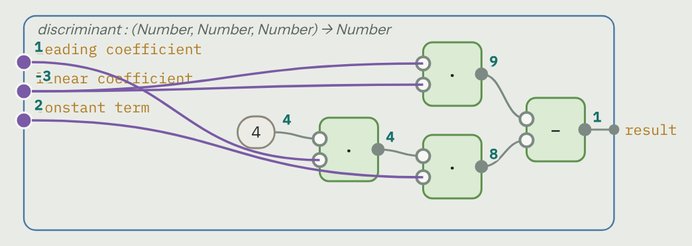
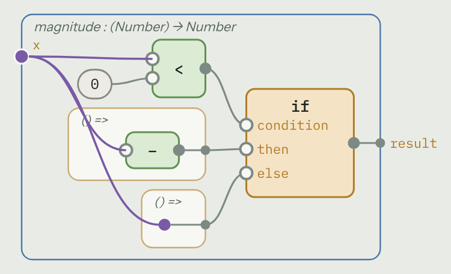
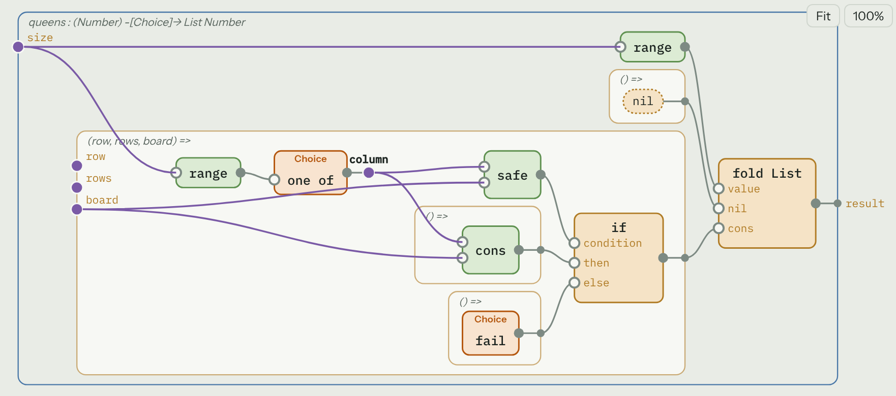
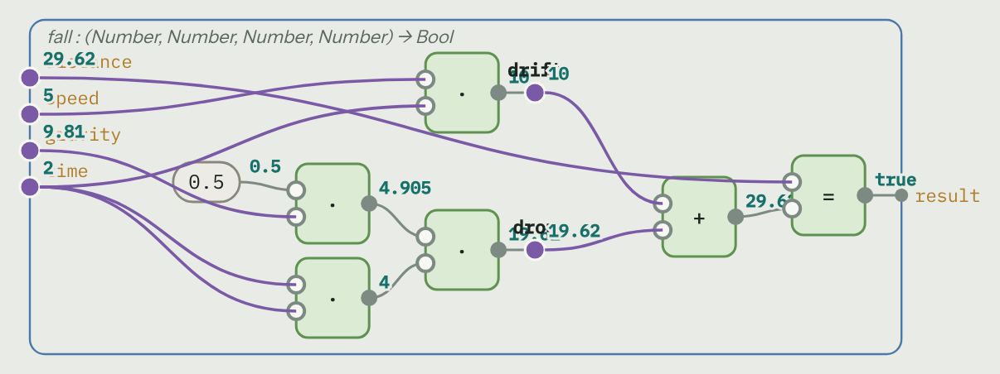
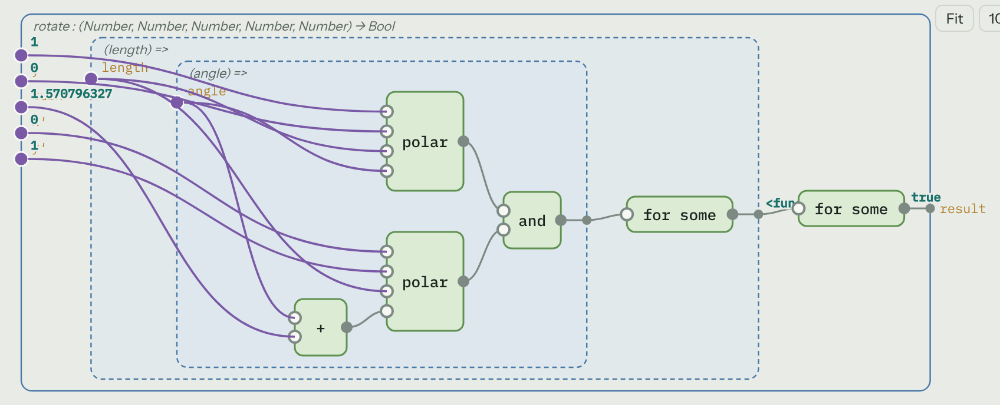
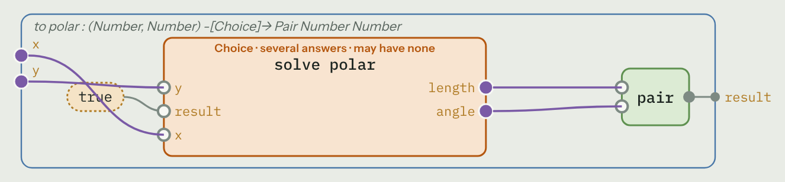
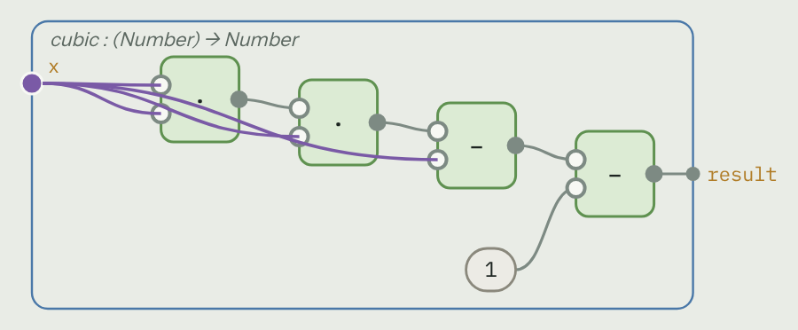
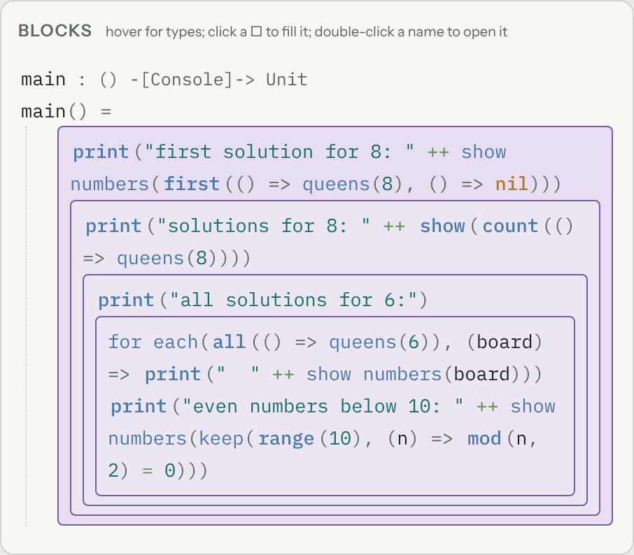
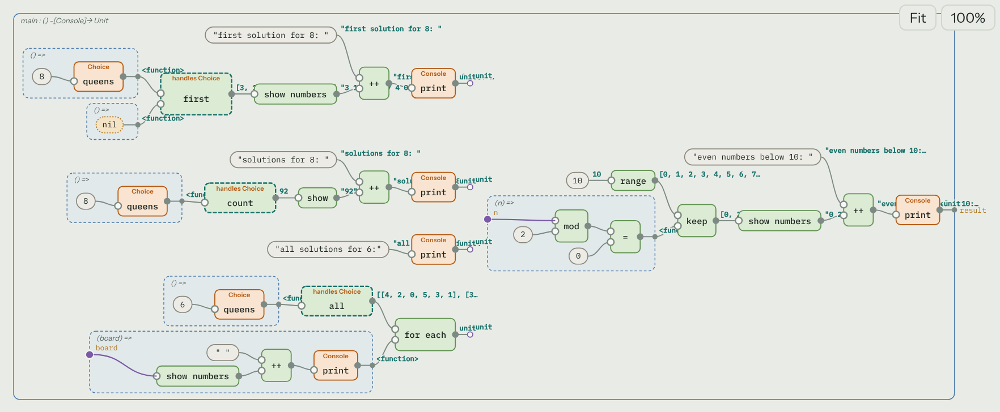

# A tutorial for the projectional language

This tutorial has two jobs. Right now it's for us: to understand the language
as it actually is in the code, and to find the parts that are confusing or
could be simpler. Later, cleaned up, it's for showing the language to other
people. The last part, [What's confusing, and what could be simpler](#whats-confusing-and-what-could-be-simpler),
is the reason it exists today, and it's meant to be the project's one list of
open problems.

Everything here can be tried in the editor:
https://ersagunkuruca.github.io/language-lab/ (or open the repository's
`index.html` locally). The examples ship with it, in the *Programs* list on
the left: *Numbers & physics* (`discriminant`, `polar`, `rotate`, `fall`),
*Insertion sort*, *Eight queens*, *Calculus*, *Run backwards* and
*Relations in programs*. *+ New program* starts an empty one of your own.

The tutorial is in three parts:

1. [For a five-year-old](#part-1-for-a-five-year-old): what this is, with no
   programming words at all.
2. [For programmers who haven't done functional programming](#part-2-for-programmers-who-havent-done-functional-programming):
   the handful of ideas the language takes from that world, in plain words.
3. [The language](#part-3-the-language), one idea at a time, each one in the
   editor.

*Last brought up to date on 2026-10-22, after PR #51. The screenshots are
from that build.*

---

## Part 1: For a five-year-old

Imagine a big table covered in little machines. Each machine has holes on its
left where you put things in and a spout on its right where something comes
out. One machine adds two numbers. One machine makes a number bigger. One
machine looks at a picture and tells you whether it's a cat.

You connect the machines with strings. A string goes from one machine's spout
to another machine's hole, and whatever comes out of the first goes into the
second. If you want the same thing to go to two places, the string splits in
two.

That's a program here: machines and strings. There's nothing to type, so you
can't make a typo. If you try to tie a string to a hole where it doesn't fit,
the string won't stick, and a little note tells you why.

Every machine works backwards, too. A machine that turns "how fast and how
long" into "how far" can also be asked "I went this far, how long did it
take?", and it figures it out. A machine that writes numbers down as words
can be handed the words and asked which numbers they were.

Some holes are still empty. That's fine: the machine knows what kind of thing
should go there, and when you point at the hole it shows you only the things
that fit.

And each machine has a sticker with its name. You can put your own stickers
on, in your own words, and the machines don't care: they still do exactly the
same thing. Your friend can use their own stickers on the same table.

---

## Part 2: For programmers who haven't done functional programming

You don't need to know Haskell or Lisp. You need six ideas, and the editor
shows all of them as pictures.

### 1. A program is values flowing through functions

In most languages a program is a list of instructions that change things:
`x = 3; x = x + 1; print(x)`. Here a program is a description of how each
value is made from other values: "the discriminant is b·b minus 4·a·c". There
is no `x = x + 1`, because nothing changes after it's made. That's why it can
be drawn: every value is a node, and every use of it is a wire.



### 2. Functions are values too

A function is something you can pass around like a number. `for each(list,
action)` takes a function `action` and calls it on every item. In the editor a
function that hasn't been called yet is a **frame**: a box whose inputs are on
its left edge and whose result leaves on its right.

### 3. "Let" is just naming a value so you can use it twice

`column = one of(range(size))` in the queens program doesn't store anything
anywhere. It means: this value, used in these two places. In the editor
that's a **dot** on a wire with two wires coming out of it.

### 4. Data comes in cases

A list is either empty (`nil`) or an item followed by the rest of a list
(`cons(item, rest)`). A Boolean is `true` or `false`. These are **data
types**, and each case is a **variant** with **fields**. When you look inside
a value of such a type, you say what to do in every case. That's `match`.
`if` is the same thing for `true`/`false`.

### 5. No loops: you walk the data instead

There's no `for (i = 0; i < n; i++)`. To do something to every item of a list,
you describe what to do for `nil` and what to do for `cons(item, rest)`, given
the answer for `rest`. That's a **fold**. Because each step works on a smaller
piece, a fold always finishes. Plain recursion (a function calling itself) is
allowed too; the language works out whether it finishes, and if it can't
tell, it says so in the function's type.

### 6. What a function *does* besides return a value is in its type

Printing, reading files, failing, giving several answers, and maybe never
finishing are called **effects**. Instead of being hidden, they're listed in
the function's type:

```
queens : (Number) -[Choice]-> List Number
main   : () -[Console]-> Unit
```

Read `-[Choice]->` as "an arrow that may give several answers, or none". You
never write types; the editor works them out and shows them on hover and in
the frame's title.

That's all the functional programming you need.

---

## Part 3: The language

### 3.1 The program is the tree; names are stickers

There is no source text. The program is stored as nodes keyed by ids in
`code.json`. Names live in separate files (`names.*.json`), as do comments
(`comments.json`), positions on the canvas (`layout.json`) and example
inputs (`examples.json`). The *Files* panel lists them, with the program's
**meaning hash**.

What this buys:

- **No syntax errors**, because there's no syntax.
- **No unknown names or typos.** A reference is an id you picked from a list.
- **Renaming is free.** It changes a names file, not the program. The
  meaning hash doesn't move.
- **Names can collide harmlessly.** Name three inputs `k` and they show as
  `k₁`, `k₂`, `k₃`. Nothing is looked up by name, so there's no shadowing.
- **Notation is personal.** The `a · b` / `a * b` / `(* a b)` switch and the
  *Short names* / *Descriptive* switch change only what you see.

**Try it.** Open *Numbers & physics* → `discriminant`. Switch between *Short
names* and *Descriptive*, and between the three notations. Watch the *Files*
panel: `code.json` and the meaning hash never change.

### 3.2 Nodes and wires

A **node** computes a value: a function call, an `if`, a `match`, a `fold`, a
`solve`. Inputs are hollow circles on its left; its output is the filled
circle on its right. A **wire** carries a value from an output to an input.

There are no variable boxes. Every use of a variable is a wire from where
that variable comes from, so a value used twice visibly fans out. In
`discriminant` above, `linear coefficient` has two wires because it's used
twice.

**Values on wires.** Teal text next to an output is the value it made when
the definition last ran on its example inputs (*Show values* in the *Run*
panel; the inputs are kept in `examples.json`, not in the code). That's
different from a name: a name is brown or black, belongs to a dot, and is
part of the names file. A value is a result and changes when the inputs do.

**Gestures.** Drag from an output (or a dot) onto an input to use that value
there. Drag an input's wire into empty space to remove it; the input becomes a
hole. Drag a node to move it, which only changes `layout.json`. *Fit* and
*100%* zoom the canvas, which is unbounded in every direction.

### 3.3 Dots: where a value starts and branches

A **dot** is where a value starts and branches out to every place that uses
it. Two things are dots:

- **A function's inputs**, on its frame's left edge.
- **A let.** Click any wire to put a dot on it. Select the dot to give it a
  name, or leave it unnamed: then it shows as `•1`, `•2`, a handle that's
  never stored. Drag from the dot to another input to share the value there.

In the code, a dot is the binder of `((b) => body)(value)`. There is no `let`
node. Removing a dot with one wire out puts the value back on that wire.

A dot that nothing reads is a step done only for its effect, like each
`print` in `main`. Those are drawn hollow.

### 3.4 Frames: functions not called yet

A **frame** is a function as a value. Its inputs are dots on its left; what
it gives back leaves on its right. A whole definition is a frame too: its
title shows its name and inferred type, e.g. `queens : (Number) -[Choice]->
List Number`.

Frames nest, and a node can't leave the frame its inputs come from. If you
drag a node out, the frame grows to keep it inside.

### 3.5 Holes: the program is allowed to be unfinished

A **hole** (`□`) is a value not filled in yet. It knows its type. Select it
and the side panel lists only fillings that fit: variables in scope, calls
(which arrive with one hole per input), constructors, numbers, text,
functions, and "match …" / "fold …" for each variable whose type has cases.
A program with holes runs until it reaches one.

**Try it.** Open *Insertion sort* → `insert`. In the blocks, click the body of
the `else` case of the `if` and press *Clear to a hole*. The hole needs a
`List Number`. The palette offers `items`, `tail`, `tail′`, `nil`,
`cons(□, □)`, `append(□, □)`, `insert(□, □)`, `sort(□)` and other things that
make lists, but not `x` or `head`, which are numbers. That's the whole idea
of "type errors prevented by the editor": you can't pick what doesn't fit.
(*Insertion sort* itself was written this way, with palette picks only.)

### 3.6 Writing your own program

- **+ New program** makes an empty program; **Save file** and **Open file…**
  write and read it as one JSON file holding the code, names, comments and
  layout together. Every edit is also kept in the browser as you go.
- **+ New definition** makes a function (give its inputs, or none for an
  action you can run), a value, or a data type (give its first case).
- *This definition* lets you rename it, add, reorder and remove inputs (every
  call gets a hole for a new input, so none is missing an argument), and
  delete it.
- **Copy** (Ctrl+C), cut (Ctrl+X) and **Paste the copy here** (Ctrl+V on a
  hole) move subtrees, with their dots and names.
- **Show inline** draws a call as the called definition's body, in place. It's
  a view: `code.json` doesn't change.
- Double-click a call to open the function it calls. Selecting a built-in like
  `+` shows **how it's defined**: its equation, and every direction the solver
  can run it in.

### 3.7 Data types, `match`, `if`, records

A data type is a definition whose body is a list of variants, each with
fields:

```
type Shape
  | circle(radius: Number)
  | rectangle(width: Number, height: Number)
```

A variant used as a function is its constructor: `circle(2)`. The standard
types `Bool`, `Unit`, `List a`, `Pair a b` and `Optional a` are ordinary data
types, not built in. Fields are ids, so two libraries can both have a field
called `name` and never collide.

`match` looks at a value and has one case per variant. In the graph it's an
ordinary node: the value goes into its first input, then one frame per case,
whose inputs are that case's fields. `if` is a match on `Bool`, drawn the
same way with inputs labelled `condition`, `then` and `else`.



Two gestures keep matches complete:

- **Split by cases…** on any expression replaces it with a match on a
  variable you pick, one case per variant, each starting as a copy of what was
  there.
- **Add a case** on a data type adds a case with a hole to *every* match and
  fold over that type. A missing case can't be written.

**Records.** A one-variant type is a record, and a field used as a function
reads it (`fst(p)`). `set(field, record, value)` is the record with one field
changed; the field can be a path, `set((p) ↦ p.home.city, ada, "Paris")`.
There's no new construct behind it: it's the field read run backwards with
the rest of the record given.

**Whole numbers and text.** `Int` is the whole numbers and never overflows
(it switches to big integers past 2⁵³). `Number` is floating point. They
don't mix without `as number` or `whole part`. Where there's no whole
answer there's no answer: `quotient` by zero is `Choice` (see 3.9), not a
crash. Text has `length`, `slice`, `split`, `join all`, `find` and friends,
and an emoji counts as one character.

### 3.8 Loops are folds

A **fold** is a match where each recursive field also comes with its
already-computed result. In `insert`, the `cons(head, tail)` case also gets
`tail′`, which is `x` already inserted into `tail`:

```
insert(x, items) =
  fold items
    nil → [x]
    cons(head, tail) with tail′ →
      if x < head then cons(x, cons(head, tail)) else cons(head, tail′)
```

In the graph a fold is the same shape as a match; the case frames just have
the extra inputs. A fold always finishes. It also works on trees whose
children are in a list (an HTML document, JSON): the folded value of the
children is the list of their results.

The eight queens program is a fold over the rows: for each row, pick a column
and keep it only if it's safe.



**Plain recursion** is allowed. The checker uses size-change termination:
following every chain of calls that comes back to where it started, some
input must get strictly smaller (a piece a match took apart from it). That
accepts one shrinking input, Ackermann-style orders, inputs that swap places,
and mutual recursion. Anything else gets the `Diverge` effect in its type,
and so does everything that calls it. `newton` in *Calculus* has `Diverge`
because nothing in it gets smaller; `with fuel(100, …)` turns that into
`Choice` (gives up after 100 steps).

Two rules keep "smaller" honest: a data type can't take itself as an input in
its own fields, and only functions can be recursive (`ones = cons(1, ones)`
is refused), so all data is finite.

### 3.9 Effects

A node whose call performs an effect carries a **badge**. These are the
effects:

| effect | what it means | made by | removed by |
|---|---|---|---|
| `Choice` | may give several answers, or none | `one of(list)`, `fail()`, `value of(optional)`, running a function backwards | `first(action, fallback)`, `all(action)`, `count(action)`, `optional(action)` |
| `Abort` | stops, with a reason | `abort(reason)`, a missing file | a `match` with an `abort(reason)` case; at the top, the run ends with the reason |
| `Log` | debugging output | `log(line)` | a `match` with a `log(line)` case; at the top, standard error |
| `Console` | reads and prints | `print(text)`, `read line()` | the runtime |
| `Files` | reads and writes files | `read file`, `write file`, … | the runtime |
| `Diverge` | might not finish | recursion the checker can't see ends | the runtime, or `with fuel(n, action)` |
| yours | what you declare | its operations | a `match` on them |

**Choice is the interesting one.** It covers several things other languages
have separately:

- **Search.** `queens` picks `one of(range(size))` for each row and calls
  `fail()` if it isn't safe. There's no search code. `first` gives one board,
  `count` gives 92, `all` gives every board.
- **Absence.** There's no `null`. "Might not have a value" is `Choice` in the
  type, and something must handle it before `main`. When an absent value has
  to be *stored* (in a list or a record), it's `Optional`: `none` or
  `some(value)`, a case you match on.
- **Filtering.** `keep(list, test)` is `all(() => item = one of(list); if
  test(item) then item else fail())`.
- **Several answers from running backwards.** See 3.10.

**Abort is failure with a reason**, and only one answer. `read file` aborts
with "no such file: notes.txt", and an ordinary `match … | abort(why) → …`
catches it. Rule of thumb: `Choice` for search and "no answer", `Abort` for
errors someone should read, `Optional` to keep an absence in data.

**Effects you define** are declared like a data type whose cases are
operations: `effect Ask = ask(question: Text) returns Number`. Calling
`ask("width")` performs it. Handling it is a `match` on the computation that
performs it, with one case per operation:

```
match width() + height()
| ask(question) → if question = "width" then 30 else 12
```

So there's no new node for handlers: a handler is a match, an operation is a
case, performing is calling.

**Two safety rules.** A definition's own value must be pure; anything that
acts is an *action*, a function with no inputs (the `() =>` frames handlers
take). And the world (`Console`, `Files`) may not be touched while a `Choice`
is open: printing on a search path that's later abandoned would still have
printed. Handle the search first, then act on its result.

Effects compose with no extra machinery. `map` has type
`(List a, (a) -[e]-> b) -[e]-> List b`: whatever effects the function you pass
has (`e`), `map` has too. There's no `map` vs `mapM`.

**Try it.** Open *Eight queens* → `main` and press *Run main*: the first
solution for 8, the count (92), and all four solutions for 6.

### 3.10 Running any function backwards

Every function has **ports**: its inputs and its result. Running it forward
means giving it the inputs and asking for the result. But you can give it
any of its ports and ask for the others. *Run* in the side panel lists the
ports of whatever definition you're looking at, each with a tick box: ticked
ports are ones you give, the others are worked out. Which ones are ticked is
stored in `layout.json`, not in the code, so flipping them changes the
direction, not the program.

This isn't limited to arithmetic. Every node has a backwards reading
(BACKWARDS.md has the table): a constructor takes its value apart, an `if`
becomes a choice between its cases, a fold becomes an unfold, `join text`
tries every way to cut the text. From *Run backwards*:

- `magnitude` (the `if` above) run backwards from 5 gives −5 and 5.
- `show numbers` is a printer written as a fold. Run backwards on
  `"10 20 30"` it gives `[10, 20, 30]`: nobody wrote a parser.
- `greet` builds `"hello, " ++ name`; run backwards on `"hello, Ada"` it
  finds `Ada`.
- `map(square, list) = [4, 9]` run backwards gives four lists.

Some things only run forward (`print`, `floor`, comparisons that would need
to produce a number), and the checker or the search says so instead of
guessing.

**A function that says true or false is a set of equations.** What used to be
a "network" is now an ordinary definition that returns `Bool`. `fall` has
four inputs:



Each `equal` (`=`) in it is an equation, `and` puts several together, and a
dot on a wire (`drift`, `drop`) is just a name for part of one. Run it with
*holds* ticked and `true`, and it solves for whichever ports you left
unticked, keeping it true. Give it `distance` and ask for `time`: thrown down
at 5 m/s, 29.62 m takes 2 s. The other root, about −3.02 s, is listed as
another answer, and *The program it derives for this direction* shows the
quadratic formula the solver worked out.


Two more words make true-or-false functions as expressive as wiring:

- **`for some`** names a value that isn't an input. `rotate(x, y, turn, x′,
  y′)` says: for some `length` and `angle`, `polar(x, y, length, angle)` and
  `polar(x′, y′, length, angle + turn)`. Its unknowns are the wires inside.
- **`hence`** adds something that follows from what came before. `polar`
  says `x = length · cos(angle)` and `y = length · sin(angle)`, hence `x² +
  y² = length²`. The consequence gives the solver a way in (from `x` and `y`
  it finds `length` with a square root, no search) without counting as an
  extra condition.



**Units are part of the type.** Declare `m` on `distance` and `m/s²` on
`gravity` (select an input or a number; *Unit* shows chips) and the rest is
inferred: `period` comes out in seconds, `drift` and `drop` in metres. An
edit that would add metres to seconds is refused like any other type error.
A plain number is dimensionless; `9.81 m/s²` carries its unit.

**`equal` on numbers is approximate**: two numbers are equal when they agree
to 1e-9 relative, so `0.1 + 0.2` equals `0.3`. That's what a wire between
two quantities should mean, and it's why `fall` can be solved and then
checked.

**Solve nodes** do the same inside a program (*Relations in programs*). The
ports you give it are inputs; the ones it solves for come out on its right,
all from the same solution:



Its effect comes from the direction: one answer that can't fail is pure (the
missing addend of a sum); several answers, or possibly none, is `Choice`.
`square` read backwards (`x · x = y`) gives both roots of 9 under `all`
(canonical first, so `first` gives 3), and none for −1. This is the "x² = 4
has a canonical answer" idea, written as a program, and it uses the same
`Choice` as queens.

### 3.11 Calculus on real functions

`derivative(f)` reads a function's graph and builds its derivative as
another function. *Calculus* has `cubic(x) = x·x·x − x − 1`, and `cubic′`
next to it in the list was generated from it: the chain rule at every node,
with each operation's partial derivatives taken from the same table that
evaluates and inverts it.




It goes through lets, calls of other definitions (each gets its own
generated derivative), `if` and `match` (each case differentiated), and
folds (a fold that carries value-and-slope pairs, which is forward-mode
automatic differentiation written in the language itself). Where it can't
read a slope (through `floor`), the derivative fails there, so its type has
`Choice`.

The other half of calculus is running backwards: `zeros of cubic` is `cubic`
run backwards from 0, and `zeros of x² − 2` gives both `±1.414…`, where
Newton's method would find one.

### 3.12 The errors you can't make

Every edit is a pure function from program to program, and it's refused, with
the reason in the status line, if the result has an error the program didn't
have before. The editor also asks ahead of time: while you drag, the inputs
you can reach light up and the others say why not.

| error | status | why |
|---|---|---|
| syntax | impossible | there is no text |
| unknown name, typo | impossible | references are ids picked from a list |
| name clash, shadowing, capture | impossible | binders are ids; equal names get a subscript on screen |
| wrong number of arguments | prevented | a call is made with one hole per input; adding an input adds a hole to every call |
| type mismatch | prevented | holes only offer what fits; edits that add one are refused |
| unit mismatch | prevented | units are part of `Number`'s type |
| missing case | prevented | cases come from the type; *Add a case* adds hole cases everywhere |
| null / undefined | impossible | there is no null; absence is `Choice` or `Optional` |
| integer overflow | impossible | `Int` is unbounded |
| errors without a reason | checked | `Abort` carries one; your own effects carry typed ones |
| unhandled effect | checked | effects are in types; `main` can't keep `Choice` |
| side effects on an abandoned search | checked | the world can't be touched while a `Choice` is open |
| comparing functions | checked | `equal` needs plain data |
| non-termination | inferred | it shows up as `Diverge` in the type |
| unfinished program | allowed | holes have types; it runs until it reaches one |
| `sqrt` of a negative, `÷ 0` on `Number` | runtime | `Number` follows IEEE (NaN, Infinity); `Int` division by zero has no answer |
| logic errors | not prevented | running backwards gives round-trip laws to test against |

The *Checks* panel lists these live for whatever program is open.
LANGUAGE.md has the full table, with which test shows each row.

### 3.13 Libraries, and how it runs

**Libraries are named by their content.** `map`, `keep`, `reverse`,
`for each` and the rest of the prelude are published: each definition's id
is the hash of what it is, so a reference to it says exactly which `map`,
forever, and there are no import statements. Two people who publish the same
function get the same hash, so their copies are one. Published code can be
opened and read, but not edited. A **pin** freezes a definition's inferred
type, so an edit that changes it is reported at the definition, not at some
caller far away.

**It runs three ways.** The evaluator (what *Run* uses) has no stack limit:
summing a million numbers by recursion works. The relational interpreter
runs anything backwards. And the compiler (`compiler/`, COMPILER.md) turns a
program into JavaScript; eight queens runs about 600× faster compiled, and
its search becomes the backtracking loop you'd write by hand. The compiled
programs are tested to print exactly what the evaluator prints.

**Data can be stored differently from how it's written.** NUMBERS.md's proof
of concept writes `factorial` on Peano naturals (`zero | succ(Nat)`) and runs
it on binary, by a rewrite that the definition never mentions (`npm run
numbers`; not in the editor yet).

### 3.14 Summary: the vocabulary

These are the words the in-editor Guide uses, one word per thing:

| word | what it is |
|---|---|
| node | something that computes a value: a call, an if, a match, a fold, a solve |
| wire | carries a value from an output (or dot) to an input |
| dot | where a value starts and branches: an input of a function, or a let |
| frame | a function not called yet: inputs on the left, result on the right |
| hole | a value not filled in yet, with a type |
| badge | the effects a node has, or the effect it handles |
| solve | any function run backwards: you give some ports, it works out the rest |

---

## What's confusing, and what could be simpler

This is the candid part, and the one list of open problems. Each item says
what's there today, why it's a problem, and a proposal. [REVIEW.md](REVIEW.md)
has the longer review, [ROADMAP.md](ROADMAP.md) the order of work (items 1
to 3 below are its item 1), and [NOTES.md](NOTES.md) the design discussion
behind them. Fixed items are at the end, so the list shows what moved.

### 1. Sequences are drawn as nesting

**Today.** Adjacent steps are nested inside each other. In the blocks view of
*Eight queens* → `main`, each `print` is a box inside the previous one's box,
five levels deep for five prints. The same happens to a run of lets, and a
list written out (`[4, 9]`) is `cons(4, cons(9, nil))`, a chain of nodes.
It's the Peano / linked-list problem again: the structure is right, the
picture isn't.



**Why.** A step `a; b` is stored as a let whose body is `b`, and a let is a
function call, so each step really is inside the one before. The *As text*
panel already prints steps flat and a list as `[x]`; the blocks and the graph
don't.

**Proposal.** Keep the storage, change the view. A chain of lets or steps is
drawn as one flat list of rows (the graph already puts effect-only steps in a
column; the blocks should too). A `cons` chain that ends in `nil` is drawn as
`[a, b, c]`, one node with an input per item and a spare input to add one.
The same rule could later show `succ(succ(zero))` as `2`: a view that's chosen
per type, the way NUMBERS.md chooses a representation.

### 2. The graph doesn't scale yet

**Today.** Look at *Eight queens* → `main` in the graph:



- **Labels overlap.** Value captions sit on top of input names (`fall`'s
  `29.62` over `distance`, `drift` over `10`), and a dot's name and its value
  print in the same spot. Every `print` shows `unitunit`.
- **Wires cross nodes and each other**, and nothing spaces nodes out. The
  `size` wire in `queens` runs through the case frame's input names.
- **Nodes are placed relative to what they feed**, with offsets saved from an
  automatic layout. Moving one thing can move others.
- *Fit* doesn't center horizontally, the graph panel can't be resized, and
  there's no right-click menu for adding a node, searching or inlining.

**Proposal.**
- Value captions in a small pill attached to the wire's start, hidden by
  default when they'd overlap, shown on hover; names on dots only.
- An automatic layout that minimizes crossings (layered, Sugiyama-style, as
  ELK and Graphviz do), runnable on the whole graph or on a selection, that
  treats wires as obstacles too. Where crossings remain, draw a small
  **bridge** where a wire crosses a wire and a **tunnel** (a gap) where it
  passes under a node.
- Free positions: a node's position is its own, stored absolutely; the
  automatic layout only places nodes that have none.
- Per-dot choice of drawing: a dot can be a **junction** (today) or a
  **named let node** plus **get nodes** where it's used (Unreal's and
  Houdini's "named reroute"), so a value used far away doesn't need a long
  wire. That's a view stored in `layout.json`; the code is the same let.
- A right-click menu on the canvas and on nodes: add (the palette, searched),
  inline, open, put a dot, lay out the selection.

### 3. Captioned wires and named dots look alike, and mean different things

**Today.** Text next to a wire is either a **value** (teal: what this output
made for the example inputs) or a **name** (on a dot: what a let is called).
Both are small text near a wire, so it reads as if some wires have names.

**Should there be a difference?** Between a value and a name, yes. A name is
presentation of the code (it lives in the names file, and renaming changes
nothing). A value is a run result (it lives in `examples.json` and changes
when the inputs do). The fix is to make them look different (item 2's pill
for values), not to merge them. Between a *name* drawn on a wire and a name
drawn on a dot, no: both name the same let, so a captioned wire would be one
more way to draw a named dot, next to the junction and the let/get pair
(NOTES.md, "The node editor").

### 4. Cases that are values are drawn as functions

**Today.** The `then` and `else` of an `if`, and every case with no fields
(`nil`), are drawn inside `() =>` frames, because internally they run only
when chosen. In `queens`, `fail` sits inside its own frame under `else`, and
`nil` inside another; in `magnitude`, the `else` frame holds nothing but a
wire.

**Proposal.** Draw a zero-input frame as just its contents, with no box,
unless it's a real action passed to a handler like `first` or `all`.

### 5. "Output" and "dot" are almost the same thing

**Today.** A node's output is a filled circle on its right. Dragging it to a
second input creates a dot on its wire. Inputs of functions are dots, the
solved ports of a `solve` node are dots, but a node's output isn't.

**Proposal.** Every output is a dot. A value used once is a dot with one
wire; there's nothing to create when you use it a second time. That removes
one shape and one gesture.

### 6. Order is invisible

**Today.** A dataflow picture has no order. In the graph of `main`, the five
prints are scattered across three rows; nothing says which runs first. A fold
computes its children before the parent, so effects inside a fold run
bottom-up, and the docs say "use `for each` when order matters".

**Proposal.** Draw a thin "then" wire between effectful steps, the way Unreal
Blueprints have execution pins, and lay the steps out along it. That also
gives item 1's flat list a shape in the graph.

### 7. `for some` is drawn as nested frames

**Today.** `rotate` has two internal wires, `length` and `angle`, and they
appear as two nested `(length) =>` / `(angle) =>` frames feeding two `for some`
nodes. An existential is the honest meaning, but the picture of "a wire that
isn't an input" is two boxes and two nodes.

**Proposal.** One `for some` with several inputs, or draw an existential as a
dot inside the frame with no wire coming in, labelled "some".

### 8. Effects: seven of them, and the editor shows three

**Today.** The language has `Choice`, `Abort`, `Log`, `Console`, `Files`,
`Diverge` and effects you declare. The guide's badge text still mentions only
Choice, Console and Diverge, the examples don't use `Abort`, `Log` or a
declared effect, and the editor can't declare an effect (*+ New definition*
offers function, value and data type). A handler is a `match` on a
*computation*, which is the same node as a match on *data* doing a different
job.

There are also three ways to say "no answer": `Choice` (no reason, maybe
many), `Abort` (a reason, one) and `Optional` (stored).

**Proposal.** An example that uses `Abort` and a declared effect, the guide
updated, and "Effect" as a fourth kind in *+ New definition*. Draw a handler
match with its cases labelled as operations ("when it asks…"), so it's
visibly a handler. Teach the three absences with the rule of thumb in 3.9.

### 9. The type syntax has a variable most people won't understand

**Today.** Types like `(List a, (a) -[e]-> b) -[e]-> List b` show `e`, a row
variable meaning "whatever effects the function you pass has". `root near`'s
type is `((Number) -[Choice, Diverge, e]-> Number, Number) -[Choice, e]->
Number`.

**Proposal.** Show it in words on hover ("has the effects of `f`") and hide
`e` by default. The badges already say what a node does.

### 10. Three ways to repeat

**Today.** `fold`, plain recursion (with termination inferred) and `with fuel`
(recursion with a limit). They exist for good reasons, but a newcomer will
ask which to use.

**Proposal.** Teach fold first and present recursion as "a fold the checker
couldn't see", and fuel as "recursion with a budget".

### 11. Libraries: visible but frozen

- You can open a library function and read it, but any edit inside it is
  refused, because changing it would change its name. The missing gesture is
  "copy into my program", which makes a draft you can change and later
  publish as a replacement.
- Pins exist in the checker, but the editor can't pin one of your own
  definitions, and doesn't show which ones are pinned.

### 12. Small inconsistencies worth fixing

- `if` draws its cases in the order they're stored: in `insert`, `else` comes
  before `then`. It should always be `condition`, `then`, `else`.
- The palette labels some fillings with an empty name ("match , match ,
  fold"), for values that have no name of their own.
- `+` is still three built-ins in tree code (`add`, `subtract`, `negate`), each
  with its own equation, where one sum `a + b = total` read in different
  directions would do.
- `Int` and `Number` share every operation's name. The types tell them apart
  and the palette only offers the right one, but a reader of the blocks can't
  see which `+` it is.
- `equal` on numbers is approximate (1e-9). That's the right default for a
  wire, but bit-exact comparison has no name yet.
- The docs overlap: LANGUAGE, BACKWARDS, NUMBERS, COMPILER, REVIEW and this
  tutorial each restate parts of the model and the error table. LANGUAGE.md
  should be the reference, the rest should link to it.

### 13. Things that are good and should stay

So the list above isn't read as "everything is wrong":

- Names, comments, layout and examples outside the code. Rename, notation,
  layout and example values never change meaning, and the Files panel shows it.
- Holes with types and a palette of only what fits.
- *Add a case* adding holes everywhere.
- One `Choice` effect covering search, absence, filtering and every backwards
  run.
- Any function runs backwards, including printers, which become parsers.
- Derivatives read off real functions, generated as definitions you can open.
- Non-termination as an inferred effect, rather than a promise.
- Libraries by content hash, with no import statements.

### Fixed since the first version of this list

- ~~**Two worlds of functions.**~~ A network is now a function returning
  `Bool`, built from `equal`, `and`, `for some` and `hence`; one interpreter
  runs every backwards direction, and the network node kinds, editor and
  checker are gone (LANGUAGE.md, "One world").
- ~~**Builtins are black boxes, and arithmetic exists three times.**~~ There's
  one table of arithmetic (evaluate, invert, differentiate); selecting a
  built-in shows its equation and directions; the data-type algebra demo was
  replaced by calculus on real functions. (What's left is item 12's three
  `+`s.)
- ~~**Relations only cover arithmetic.**~~ Every node runs backwards
  (BACKWARDS.md), and pattern matching *is* a constructor run backwards.
- ~~**Units only exist in networks.**~~ Units are part of `Number`'s type in
  every program.
- ~~**`equal` works on functions; `show` only on numbers.**~~ `equal` needs plain
  data; `show` prints any plain value.
- ~~**The editor can't make anything.**~~ New programs, definitions, data types
  and inputs; save and open files; copy and paste; values on wires.
- ~~**Absence and errors have no reason.**~~ `Abort`, `Optional` and effects you
  declare.
- ~~**Totality has holes.**~~ Strictly positive types, size-change termination,
  no recursive values (REVIEW.md §1).

---

## Where this lives

- This file: `projectional/TUTORIAL.md`. The editor build also turns it into
  `tutorial.html` at the site's root, linked from the editor's header.
- The language reference: [LANGUAGE.md](LANGUAGE.md). Running backwards:
  [BACKWARDS.md](BACKWARDS.md). Numbers and representations:
  [NUMBERS.md](NUMBERS.md). The compiler: [COMPILER.md](COMPILER.md). The
  review: [REVIEW.md](REVIEW.md). What's next: [ROADMAP.md](ROADMAP.md), and
  the discussion behind it: [NOTES.md](NOTES.md). The prototype and editor:
  [README.md](README.md).
- Screenshots are in `projectional/tutorial/`.
